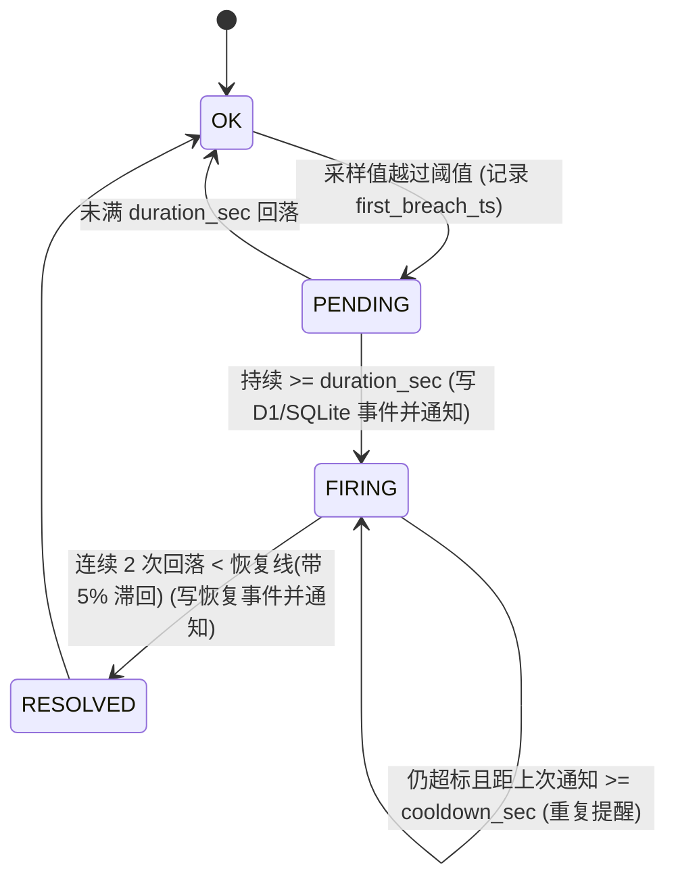

# UniOB (Unified Observability) 技术设计规范 (Technical Specification)

> 可选“网络质量 TCP 探测”与“节点自动更新”协议扩展分别见 [features/network-quality.md](features/network-quality.md) 与 [API.md](API.md)。

- **文档版本**：`v2.0.0`
- **目标场景**：多台 Linux 服务器（含 1G/2G 小内存 VPS）的安全只读监控、按需进程透视与实时告警系统
- **架构底座（Architecture v2）**：
  - **被控端**：纯静态 Rust `musl` 探针（`uniob-agent` v2，Protocol v2 批量与金丝雀热迁移）
  - **中心端双模对等**：
    - **方向 B（SCCH 边缘中枢）**：Cloudflare Workers + Static Assets + D1 + 同址单例 `FleetHubDO`（WebSocket Hibernation + Zero-DELETE Ring-Slab TSDB + Welford 流式聚合）
    - **方向 A（自建节点中枢）**：独立 Rust `uniob-hub`（`axum` + SQLite WAL + 本机 `/proc` Loopback 自采集）+ Cloudflare Workers Free 5 分钟 Cron 死开关看门狗

---

## 1. 设计目标与刚性约束 (Goals & Constraints)

### 1.1 核心目标
1. **极致轻量的被控端**：在 1GB RAM 低配 Linux VPS 上常驻内存（RSS）控制在 **3 MB ~ 6 MB**，静态二进制体积 **<= 2,621,440 字节（2.5 MB，Windows Release 实测 `1,498,112` B）**，静默巡航 CPU 占比接近 `0.0%`。
2. **绝对只读安全边界**：被控端无需开放任何入站端口（纯出站 `WSS 443`），下行控制帧仅允许固定枚举采样挡位（`0`/`1`/`2`）、水位阈值与经 HMAC-SHA256 验签的 `migrate` 目标地址；`systemd` 通过 `ProtectSystem=strict` + `NoNewPrivileges=true` + `MemoryMax=24M` 锁死权限边界，仅授权可写状态目录 `StateDirectory=uniob`（`/var/lib/uniob`）。
3. **Cloudflare Free 可持续运行（SCCH）**：通过 Co-Located 单 DO 同址架构、5m UTC 相位锁定批量上报、Zero-DDL 冷唤醒、Push-Invalidated D1 本地镜像与 Zero-DELETE 环形分块 TSDB，打破 v1 每台 `~13,584` 写入/日的瓶颈，将 Idle 日写入压降至 **`888` 行/节点/日 + `96` 集群安全闹钟（10 台实测 `-93.4%`）**，使 **Idle `<= 112` 台 / 2h 运维 `<= 75` 台 / 24x7 墙板 `<= 16` 台** 均可在 **Workers Free (`$0.00/月`)** 稳定运行。
4. **双模自由迁移与混合高可用（Direction A）**：随时可将全部节点密钥哈希、告警规则、通知渠道与月流量账本无损导出为状态 Bundle 并切换至任一自有 VPS 上的 `uniob-hub`，同时以极简 Cloudflare Workers Free Watchdog 解决“自建中枢自身断电/失联无人告警”盲区。
5. **准时且不扰民的告警**：原生利用状态机防抖、滞回恢复、维护静默及边缘水位瞬时冲刷，支持 Telegram Bot（含群组 Topic）与通用 Webhook 闭环通知。

### 1.2 明确不做的事（Non-Goals）
- **不做远程控制功能**：不包含 Web SSH、远程脚本下发、远程杀死进程（`kill`）、容器启停或文件管理。
- **不做高基数日志/APM 收集**：不采集全量业务日志文件或分布式调用链，聚焦主机与系统进程级可观测性。

---

## 2. 系统总体架构与 7 维度 Cloudflare 计费精算

### 2.1 双模对等拓扑架构

UniOB v2 支持 **方向 B（Cloudflare SCCH 边缘同址中枢）** 与 **方向 A（自建 `uniob-hub` + Cloudflare 死开关看门狗）** 两种部署形态，并支持通过状态 Bundle 与 HMAC 金丝雀热迁移在两者间平滑切换：


> 注：历史兼容性类 [`NodeDO`](../worker/src/do/node-do.ts) 仍在 [worker/src/index.ts](../worker/src/index.ts) 与 [worker/wrangler.jsonc](../worker/wrangler.jsonc)（`v1` migration）中保留导出以维护存量部署迁移兼容；所有生产实时读写与聚合路由均已统一收口至 [`FleetHubDO`](../worker/src/do/fleet-hub-do.ts)。

### 2.2 方向 B（SCCH — Synchronized Cohort Co-Located Hibernation）6 大核心机制

1. **Co-Located 单 DO 同址汇聚（`FleetHubDO`）**：将所有 Agent WebSocket 与管理员 Browser WebSocket 汇聚至同一全局单例 `FleetHubDO`（`getByName("global")`），在同一 V8 Isolate 内存空间中完成采样帧接收、告警判定与前端广播（`fleet_batch` / `fleet_tick` / `node_detail`），彻底消灭 `NodeDO ↔ FleetHubDO` 双向跨 DO RPC（**`0` 跨 DO RPC**），并将整个机群的实例内存计费收敛为 **`1 × 128 MB`**。
2. **`setWebSocketAutoResponse` + `< 512 B` 紧凑 Attachment**：在 `FleetHubDO` 构造函数中注册 `ctx.setWebSocketAutoResponse(new WebSocketRequestResponsePair('{"op":"ping"}', '{"t":"pong"}'))`；浏览器每 `25s` 心跳与探针每 `20s` RFC 6455 Ping/Pong 均由 Cloudflare 边缘自动回复，**0 次 DO 请求、0 GB-s 唤醒计费**。Agent/Client attachment 字段高度精简并严格控制在 `< 512 B`（远低于 `2,048 B` Hibernation 限制）。
3. **UTC 相位锁定 `5m` Cohort 批量帧（`mb`）+ 边缘水位即时冲刷**：
   - 静默态（`mode = 0`）下，探针每 `30s` 将 16 元紧凑数组 `CompactMetricTuple` 写入 12 槽位环形缓存，仅在 **UTC `5` 分钟整点 + `[0, 400)` ms 确定性哈希抖动** 时发一帧 `t = "mb"`（`288` 帧/节点/日，20:1 折算仅 **`14.4` DO 请求/节点/日**），将全集群冷唤醒高度对齐为每 `5` 分钟一次脉冲。
   - DO 通过 `ctrl.watermarks` 向探针下发启用中的 CPU / Steal / Mem / Swap / Disk 最小阈值；探针内置 `EdgeDetector`（带 `3%` 恢复滞回）、`|Δcpu| >= 35%` 突刺与重启检测（`curr_up < prev_up`），一旦命中立即发送 `reason = "edge"` 批帧，保证 **危急告警 `0s` 延迟**；查看历史 `1h` 曲线若尾点滞后 `> 35s`，DO 主动下发 `flush_now: true`（最多等待 `350ms`）实时拉齐。
4. **Zero-DDL 冷唤醒检查 + Push-Invalidated 本地 D1 镜像**：冷唤醒时检查 `sqlite_master` 与 `hub_meta(key = 'schema_version') >= '2'`，绕过重复 `CREATE TABLE` DDL；配置表（`nodes_mirror`、`alert_rules_mirror`、`channels_mirror`）仅首个生命周期按 `mirror_seeded` 从 D1 拉取一次，后续管理操作通过 RPC（`syncNodeConfig`、`refreshRulesAndChannels`）增量推送，**稳态与告警评估路径 `0` 次热路径 D1 查询**。
5. **Zero-DELETE Ring-Slab 分块环存 + Welford 在线流式聚合 + 惰性合表**：
   - [tsdb-slab.ts](../worker/src/do/tsdb-slab.ts) 以小端定长二进制 BLOB 存储三级环存块：`metrics_chunk_10m`（`144` 槽 × `600s` = `24h`，每点 `76 B`）、`metrics_5m_chunk_1h`（`720` 槽 × `3600s` = `30d`，每点 `88 B`）、`metrics_1h_chunk_1d`（`366` 槽 × `86400s` = `366d`，每点 `88 B`），以 `(node_id, slot)` 为冲突键，仅更新 `bucket_ts` 与 `payload` 覆盖过期槽，**`0` 次时序 `DELETE`**、**`0` 次 `SELECT ... GROUP BY` 扫描**。
   - `node_state` 单行整合了在线状态、快照、`welford_5m_json`、`welford_1h_json` 与月流量账本；高频 `mode = 1/2` 下仅当到达 `>= 30s` 落盘点、状态切换、跨账期/重启或未落盘流量增量 `>= 64 MiB`（`TRAFFIC_COALESCE_BYTES`）时写盘。
6. **事件驱动断连闹钟 + 4 挡自适应租约 + Page Visibility 生命周期**：无客户端、无在线节点时调用 `deleteAlarm()`（`0` 闹钟写）；存在在线节点时设 `SAFETY_ALARM_MS = 15m` 集群总兜底（`96` 次/集群/日）；仅在 `webSocketClose`/`webSocketError` 时精准设定 `60s`（`OFFLINE_THRESHOLD_SEC`）离线触发。前端 `useFleetSocket.ts` 在标签页隐藏（`visibilitychange`）、离开大盘或无操作超过 `10` 分钟后立即发 `unsub_fleet`，避免后台无效拉高采样频率。

### 2.3 7 维度 Cloudflare 计费精确对比（Baseline vs SCCH vs Direction A）

#### 2.3.1 官方计费基准与核算前提（按 `30 天/月` 计算）
- **Workers Free 上限**：Worker 请求 **`100k / 日`**（`10ms` CPU/请求）；DO 请求 **`100k / 日`**（入站 WS **`20:1`** 折算，出站 WS 与 `setWebSocketAutoResponse` / RFC 6455 Ping 计 `0`，DO Alarm / RPC 各计 `1` 次）；DO 计算时长 **`13,000 GB-s / 日`**（`128 MB = 0.125 GB` 内存，符合 Hibernation 的空闲期计 `0 GB-s`）；DO SQLite 写入 **`100k 行 / 日`**；DO SQLite 读取 **`5M 行 / 日`**；DO 存储 **`5 GB`**；D1 写入 **`100k 行 / 日`**；D1 读取 **`5M 行 / 日`**；Cron Triggers **`<= 5`** 个。
- **Workers Paid 费用体系（`$5.00/月` 基础费）**：① Worker 请求（含 `10M/月`，超额 `+$0.30/M`）；② DO 请求（含 `1M/月`，超额 `+$0.15/M`）；③ DO 计算时长（含 `400k GB-s/月`，超额按每起算 `1M GB-s` `+$12.50/M`）；④ DO SQLite 写入（含 `100M/月`，超额 `+$1.00/M`）；⑤ DO SQLite 读取（含 `50B/月`，超额 `+$0.001/M`）；⑥ D1 写入（含 `50M/月`，超额 `+$1.00/M`）；⑦ D1 读取（含 `25B/月`，超额 `+$0.001/M`）；DO 存储含 `5 GB`（实测 200 节点仅 `~0.35 GB`，三方案均 `$0.00` 超额）。

#### 2.3.2 各场景核心公式分解
- **三种业务负载**：
  - **Idle（`0h/日` 看盘）**：无浏览器访问，纯后台采集与告警巡检；
  - **2h/day Active Ops（`2h/日` 运维看盘 + `22h/日` Idle）**：按每天 `7,200s` 连续开启大盘（SCCH 保守以全时 `mode=1` `10s` `FLEET_PULSE` 计算，`30` 次 REST API 请求 + `4` 次历史图表查询）建模；
  - **24x7 Wallboard（`24h/日` NOC 大屏）**：全天 `86,400s` 持续大盘直播（`10` 次 REST 刷新）。
- **v1 Baseline 公式（`N × NodeDO` + `1 × FleetHubDO`）**：
  - DO 请求/日：`Idle = 144N`；`2h Ops = 4,152N + 285`（含 `3,600N` `pushFleetTick` + `240N` `updateWatchLease` + `240` Hub 闹钟）；`24x7 = 48,240N + 3,063`。
  - DO 时长 `GB-s/日`：Idle 冷唤醒（`2,880` 帧 × `~12.5 ms` 含 5 DDL + D1 往返）`4.5N`；Live 帧（`2s` 跨 DO RPC + SQLite）`~21 ms/帧` -> `24x7 = 113.4N + 2.2`。
  - DO SQLite 写/日：`Idle = 13,584N`；`2h Ops = 13,833N`；`24x7 = 16,567N`（含 `2,880` raw/traffic/meta + `312` rollups + `3,192` TTL `DELETE` + `1,440~1,543` `setAlarm` + lease 持久化）。
  - D1 读/日：Idle 下 `10s` 休眠丢失 `rulesCache` 导致每 `30s` 重读 D1（`17,280N`）。
- **SCCH 公式（`1 × FleetHubDO`，含 `wrangler.jsonc` 1 条 `*/5 * * * *` Watchdog 巡检 Cron 与前端 `50s` `{"op":"renew"}` 续约）**：
  - Worker 请求/日：`288`（Cron 判定）`+ API`（`0` / `30` / `10`）。
  - DO 请求/日：`Idle = 14.4N + 96`；`2h Ops = 49.2N + 126`；`24x7 = 432N + 96`。
  - DO 时长 `GB-s/日`：`Idle = 288 × (0.015 + 0.004N) × 0.125 + 0.06 ≈ 0.144N + 0.60`；`2h Ops ≈ 0.285N + 0.65`；`24x7 ≈ 1.84N + 0.22`。
  - DO SQLite 写/日：`Idle = 888N + 96`；`2h Ops = 1,320N + 240`；`24x7 = 6,072N + 1,729`；`0` `DELETE`。
  - D1 读/日：`0` 热路径查询（仅 Cron 检查配置 `576/日` + 管理 API `api_reqs × (N + 5)`）。
- **Direction A（自建 `uniob-hub`）+ CF Watchdog 公式（全维度 `O(1)` 恒定）**：
  - Worker 请求：`576/日`（`288` `POST /api/watchdog/ping` + `288` Cron）；DO 全维度：`0`；D1 写：`288/日`；D1 读：`1,152/日`。

#### 2.3.3 全量 7 维度对比矩阵（资源监控基线）

##### 场景一：Idle（`0h/日` 静默后台运行）
| 规模 | 方案 | ① Worker req/d | ② DO req/d (月M) | ③ DO GB-s/d (月k) | ④ DO SQLite 写/d (月M) | ⑤ DO SQLite 读/d | ⑥ D1 写/d | ⑦ D1 读/d | Free 可用与瓶颈 | Paid 月账单 |
| :--- | :--- | ---: | ---: | ---: | ---: | ---: | ---: | ---: | :--- | ---: |
| **10 台** | **Baseline** | `0` | `1,440` (`0.04M`) | `45.0` (`1.4k`) | `135,840` (`4.08M`) | `265,200` | `0` | `172,800` | ❌ DO SQLite 写超限 | **$5.00** |
| **10 台** | **SCCH** | `288` | **`240` (`0.01M`)** | **`2.0` (`0.1k`)** | **`8,976` (`0.27M`)** | **`28,752`** | `0` | **`576`** | ✅ **Free (DO 写 9.0%)** | **$0.00** |
| **10 台** | **Dir A + WD** | `576` | **`0`** | **`0.0`** | **`0`** | **`0`** | `288` | `1,152` | ✅ **Free (0.58%)** | **$0.00** |
| **50 台** | **Baseline** | `0` | `7,200` (`0.22M`) | `225.0` (`6.8k`) | `679,200` (`20.38M`) | `1,326,000` | `0` | `864,000` | ❌ DO SQLite 写超限 | **$5.00** |
| **50 台** | **SCCH** | `288` | **`816` (`0.02M`)** | **`7.8` (`0.2k`)** | **`44,496` (`1.33M`)** | **`133,392`** | `0` | **`576`** | ✅ **Free (DO 写 44.5%)** | **$0.00** |
| **50 台** | **Dir A + WD** | `576` | **`0`** | **`0.0`** | **`0`** | **`0`** | `288` | `1,152` | ✅ **Free (0.58%)** | **$0.00** |
| **200 台** | **Baseline** | `0` | `28,800` (`0.86M`) | `900.0` (`27.0k`) | `2,716,800` (`81.50M`) | `5,304,000` | `0` | `3,456,000` | ❌ DO SQL 写 & 读超限 | **$5.00** |
| **200 台** | **SCCH** | `288` | **`2,976` (`0.09M`)** | **`29.4` (`0.9k`)** | `177,696` (`5.33M`) | `525,792` | `0` | **`576`** | ❌ DO SQLite 写超 100k/d | **$5.00** |
| **200 台** | **Dir A + WD** | `576` | **`0`** | **`0.0`** | **`0`** | **`0`** | `288` | `1,152` | ✅ **Free (0.58%)** | **$0.00** |

##### 场景二：2h/day Active Ops（每日 `2h` 高频排障 + `22h` Idle）
| 规模 | 方案 | ① Worker req/d | ② DO req/d (月M) | ③ DO GB-s/d (月k) | ④ DO SQLite 写/d (月M) | ⑤ DO SQLite 读/d | ⑥ D1 写/d | ⑦ D1 读/d | Free 可用与瓶颈 | Paid 月账单 |
| :--- | :--- | ---: | ---: | ---: | ---: | ---: | ---: | ---: | :--- | ---: |
| **10 台** | **Baseline** | `30` | `41,805` (`1.25M`) | `135.9` (`4.1k`) | `138,326` (`4.15M`) | `251,600` | `0` | `160,290` | ❌ DO SQLite 写超限 | **$5.04** |
| **10 台** | **SCCH** | `318` | **`618` (`0.02M`)** | **`3.5` (`0.1k`)** | **`13,440` (`0.40M`)** | **`29,076`** | `0` | **`1,026`** | ✅ **Free (DO 写 13.4%)** | **$0.00** |
| **10 台** | **Dir A + WD** | `576` | **`0`** | **`0.0`** | **`0`** | **`0`** | `288` | `1,152` | ✅ **Free** | **$0.00** |
| **50 台** | **Baseline** | `30` | `207,885` (`6.24M`) | `678.9` (`20.4k`) | `691,629` (`20.75M`) | `1,245,200` | `0` | `800,850` | ❌ DO 请求 & SQL 写超限 | **$5.79** |
| **50 台** | **SCCH** | `318` | **`2,586` (`0.08M`)** | **`14.9` (`0.4k`)** | **`66,240` (`1.99M`)** | **`135,636`** | `0` | **`2,226`** | ✅ **Free (DO 写 66.2%)** | **$0.00** |
| **50 台** | **Dir A + WD** | `576` | **`0`** | **`0.0`** | **`0`** | **`0`** | `288` | `1,152` | ✅ **Free** | **$0.00** |
| **200 台** | **Baseline** | `30` | `830,685` (`24.92M`) | `2,715.2` (`81.5k`) | `2,766,514` (`83.00M`) | `4,971,200` | `0` | `3,202,950` | ❌ DO 请求 & SQL 写超限 | **$8.59** |
| **200 台** | **SCCH** | `318` | **`9,966` (`0.30M`)** | **`57.6` (`1.7k`)** | `264,240` (`7.93M`) | `535,236` | `0` | **`6,726`** | ❌ DO SQLite 写超 100k/d | **$5.00** |
| **200 台** | **Dir A + WD** | `576` | **`0`** | **`0.0`** | **`0`** | **`0`** | `288` | `1,152` | ✅ **Free** | **$0.00** |

##### 场景三：24x7 Wallboard（`24h` NOC 大屏常亮监控）
| 规模 | 方案 | ① Worker req/d | ② DO req/d (月M) | ③ DO GB-s/d (月k) | ④ DO SQLite 写/d (月M) | ⑤ DO SQLite 读/d | ⑥ D1 写/d | ⑦ D1 读/d | Free 可用与瓶颈 | Paid 月账单 |
| :--- | :--- | ---: | ---: | ---: | ---: | ---: | ---: | ---: | :--- | ---: |
| **10 台** | **Baseline** | `10` | `485,463` (`14.56M`) | `1,136.2` (`34.1k`) | `165,669` (`4.97M`) | `63,600` | `0` | `17,430` | ❌ DO 请求 & SQL 写超限 | **$7.03** |
| **10 台** | **SCCH** | `298` | **`4,416` (`0.13M`)** | **`18.6` (`0.6k`)** | **`62,449` (`1.87M`)** | **`31,920`** | `0` | **`726`** | ✅ **Free (DO 写 62.4%)** | **$0.00** |
| **10 台** | **Dir A + WD** | `576` | **`0`** | **`0.0`** | **`0`** | **`0`** | `288` | `1,152` | ✅ **Free** | **$0.00** |
| **50 台** | **Baseline** | `10` | `2,415,063` (`72.45M`) | `5,672.2` (`170.2k`) | `828,343` (`24.85M`) | `318,000` | `0` | `86,950` | ❌ DO 请求 & SQL 写超限 | **$15.72** |
| **50 台** | **SCCH** | `298` | **`21,696` (`0.65M`)** | **`92.0` (`2.8k`)** | `305,329` (`9.16M`) | `159,600` | `0` | **`1,126`** | ❌ DO SQLite 写超 100k/d | **$5.00** |
| **50 台** | **Dir A + WD** | `576` | **`0`** | **`0.0`** | **`0`** | **`0`** | `288` | `1,152` | ✅ **Free** | **$0.00** |
| **200 台** | **Baseline** | `10` | `9,651,063` (`289.53M`) | `22,682.2` (`680.5k`) | `3,313,371` (`99.40M`) | `1,272,000` | `0` | `347,650` | ❌ 请求/GB-s/写全面爆表 | **$60.78** |
| **200 台** | **SCCH** | `298` | **`86,496` (`2.59M`)** | **`367.4` (`11.0k`)** | `1,216,129` (`36.48M`) | `638,400` | `0` | **`2,626`** | ❌ DO SQLite 写超 100k/d | **$5.24** |
| **200 台** | **Dir A + WD** | `576` | **`0`** | **`0.0`** | **`0`** | **`0`** | `288` | `1,152` | ✅ **Free** | **$0.00** |

> **关键结论**：① 50 台规模以下日常运维，SCCH 直接省去 Paid 订阅（`$0/月`）；② 200 台 `24x7` 墙板模式下，SCCH 将月度 DO 请求从 `2.895 亿` 压缩至 `259 万`（**-99.1%**），DO 计算时长从 `680.5k GB-s` 压降至 `11.0k GB-s`（**-98.4%**），账单从 **`$60.78/月`** 降至 **`$5.24/月`**；③ 切换至方向 A 自建 `uniob-hub` 后，云端始终保持 **`$0.00/月`**，且 `uniob-worker` Cron 仅用 `1/5` 免费额度。

#### 2.3.4 可选“网络质量 TCP 探测”增量开销（按 `3` 目标 / `20s` 间隔实测）
当全局或单节点显式开启网络质量探测时，底层复用既有 `m` / `mb` 上报通道（不增加额外 WS 控制帧/DO 请求），仅增加独立环形分块与节点快照写入：
- **Idle 模式（5m 批量）**：每台每天约 `+1,034` 行 DO SQLite 写入（`888 + 1,034 = 1,922` 行/节点/日，Workers Free `100k` 行/日下约可承载 **~52 台**），负载增加约 `~6.48 MB`/节点/日；
- **24x7 Live 模式（每秒单帧 `m`）**：每台每天约 `+13,130` 行 DO SQLite 写入；
- **DO 稳态存储占用**：单节点独立块上限固定为 `146` 块 10m 原始数据（`~6.17 MB`）+ `721` 块 5m 聚合数据（`~11.54 MB`），合计约 `~17.7 MB/节点`。
- **关闭状态（默认）**：`0` 额外行写入、`0` 额外探测流量、`0` 历史存储增长。

---

## 3. 通信协议与安全规范 (Protocol v2 & Security Spec)

### 3.1 鉴权体系
1. **探针接入鉴权 (`Agent -> Edge/Hub`)**
   - 节点注册生成 `node_id`（`nd_<ulid>`）与 32 字节随机密钥 `agent_token`（`uob_live_...`），后端仅存 `SHA-256(agent_token)` 哈希（`token_sha256`）。
   - `GET /api/agent/ws` 通过请求头 `X-UniOB-Node-Id`（兼容 `?id=` query）与 `Authorization: Bearer <token>` 鉴权；Worker 在 `verifyAgentEdgeAuth` 中使用 isolate 内存 LRU 缓存命中，非法请求直接边缘 `401`，不唤醒 `FleetHubDO`。
2. **管理员面板鉴权 (`Browser -> Edge/Hub`)**
   - **内置模式（`builtin`）**：首次打开配置管理员密码（PBKDF2-HMAC-SHA256）或注入环境变量 `ADMIN_PASSWORD_HASH`（64 位 hex），签发 `HttpOnly; SameSite=Strict` 的 HMAC-SHA256 会话 Cookie（`uniob_session`，7 天有效期），含 5 分钟内连续失败 5 次触发 `429` 限流。
   - **Cloudflare Access 模式（`cf_access`）**：`Fail-Closed` 强制核验 `Cf-Access-Jwt-Assertion` RS256 JWKS 签名与 `CF_ACCESS_ALLOWED_EMAILS`（Worker 与自建 `uniob-hub` 双端同构支持）。
3. **热迁移与 Watchdog HMAC 鉴权**
   - 热迁移：`HMAC-SHA256(key = UTF8(lowercase(token_sha256)), msg = "${node_id}:${epoch}:${ws_url}")`；禁止私有/回环网段 SSRF，生产 `cf_access` 模式下禁止 `ws://`。
   - Watchdog 心跳：`X-Watchdog-Timestamp` 与 `X-Watchdog-Signature = HMAC-SHA256("${ts}:${rawBody}", secret)`，要求时钟偏差 `<= 300s`，常量时间比对。

### 3.2 Agent ↔ 中枢 WebSocket 协议 v2 (`/api/agent/ws`)

#### 3.2.1 握手帧 (`t = "hello"`, `v = 2`)
```json
{
  "t": "hello",
  "v": 2,
  "capabilities": ["mb_v2", "migrate_v1", "network_quality_v1", "auto_update_v1"],
  "migrated_epoch": 1763128000,
  "agent_ver": "0.2.0",
  "hostname": "hk-bgp-nano-01",
  "os": "Debian GNU/Linux 12 (bookworm)",
  "kernel": "6.1.0-26-amd64",
  "arch": "x86_64",
  "cpu_model": "AMD EPYC 7763 64-Core Processor",
  "cpu_cores": 1,
  "mem_total": 1020264448,
  "swap_total": 1073737728,
  "boot_time": 1762001234,
  "proc_enabled": true
}
```
> 兼容老版 `v = 1` 探针降级回单帧 `m` 与 30s 静默模式；只要探针当前通过热迁移覆盖端点（`endpoint_override`）建立连接，握手均携带 `migrated_epoch`。

#### 3.2.2 批量指标帧 (`t = "mb"`, `v = 2`) —— 静默巡航与边沿冲刷核心帧
Idle (`mode = 0`) 下探针每 30s 采集一次放入 12 槽环存，到达 5 分钟 UTC 整点（加 `[0, 400)` ms 确定性节点哈希抖动）或命中边沿触发条件时一次性发送 `mb`：

```json
{
  "t": "mb",
  "v": 2,
  "reason": "cohort",
  "pts": [
    [1763127900, 1126736, 12.1, 0.5, 0.2, 0.14, 410123776, 12582912, 6421980000, 0, 4096, 102400, 204800, 84919000000, 192837000000, 22]
  ],
  "last": {
    "ts": 1763128200,
    "up": 1127036,
    "cpu": { "all": 14.2, "cores": [14.2], "steal": 0.8, "iowait": 0.3, "load": [0.18, 0.12, 0.09] },
    "mem": { "used": 412876800, "avail": 607387648, "cached": 289406976, "swap_used": 12582912 },
    "disks": [{ "mp": "/", "fs": "ext4", "total": 21002936320, "used": 6421987328, "r_bps": 0, "w_bps": 16384 }],
    "net": { "rx_bps": 128450, "tx_bps": 349120, "rx_tot": 84920193842, "tx_tot": 192837465120, "tcp_est": 24, "tcp_tw": 11, "udp": 4 }
  },
  "network_quality": { "config_id": "<sha256>", "segment_id": 1763128000, "pts": [] },
  "upd": { "st": "idle", "ver": "0.2.0", "ts": 1763128200 }
}
```
- **`reason` 枚举**：`"cohort"`（UTC 5m 相位批）、`"edge"`（水位越界 / `|Δcpu| >= 35%` / 重启）、`"flush"`（响应 `ctrl.flush_now` 或从 `mode = 0` 切向实时挡位）、`"hello"`（握手附带缓存点）。
- **`CompactMetricTuple`（严格 16 项数值元组）**：
  `[0:ts, 1:up, 2:cpu_all, 3:steal, 4:iowait, 5:load1, 6:mem_used, 7:swap_used, 8:disk_used, 9:disk_r_bps, 10:disk_w_bps, 11:net_rx_bps, 12:net_tx_bps, 13:rx_tot, 14:tx_tot, 15:tcp_est]`。
- **可选顶层扩展字段**：`network_quality`（详见 [features/network-quality.md](features/network-quality.md)）与 `upd`（`{ st: "idle" | "downloading" | "staged" | "applying" | "error", ver?, err?, ts? }`，仅在状态变化待上报时附带，独立解析不破坏核心资源帧）。

#### 3.2.3 周期单帧 (`t = "m"`) —— 实时模式 (`mode = 1 | 2`) 与 v1 兼容
结构沿用实时完整指标负载（含 `ts`, `up`, `cpu`, `mem`, `disks`, `net`, 可选 `procs` 与顶层可选 `network_quality` / `upd`）。仅当 `mode = 2`（Live Proc）且本地 `process.enabled = true` 时携带 `procs` Top-N 数组；其余模式一律省略。

#### 3.2.4 下行控制帧 (`t = "ctrl"`) —— 四挡自适应与热迁移 / 扩展控制
```json
{
  "t": "ctrl",
  "mode": 1,
  "interval_ms": 10000,
  "batch_sec": 300,
  "top_n": 0,
  "lease_sec": 90,
  "flush_now": false,
  "watermarks": { "cpu": 90, "steal": 20, "mem": 90, "disk": 90 },
  "migrate": {
    "url": "wss://hub.example.com/api/agent/ws",
    "fallback_url": "wss://monitor.example.com/api/agent/ws",
    "epoch": 1763128500,
    "sig": "<64-char-hmac-sha256-hex>"
  },
  "update": {
    "version": "0.2.1",
    "sha256": "<64-char-sha256-hex>",
    "url": "https://hub.example.com/releases/uniob-agent-x86_64-unknown-linux-musl",
    "fallback_url": "https://github.com/Cusnd/UniOB/releases/download/v0.2.1/uniob-agent-x86_64-unknown-linux-musl",
    "issued_at": 1763128600,
    "hmac": "<64-char-hmac-sha256-hex>"
  },
  "network_quality": {
    "config_id": "<sha256>",
    "enabled": true,
    "interval_sec": 20,
    "targets": []
  }
}
```
- **签名更新指令 (`ctrl.update`)**：中枢使用节点小写 `token_sha256` 作为 HMAC-SHA256 密钥，对 `"agent_update_v1:${node_id}:${version}:${sha256}:${issued_at}:${url}:${fallback_url ?? ""}"` 签名；`network_quality.interval_sec` 范围为 `10..=300`（默认 `20` 时在规范序列化及 `config_id` 计算预像中省略以保持 v1 哈希向后兼容）。
- **中心端 4 挡控制参数（`computeCtrlForNode`）**：
  | 活跃状态 | `mode` | `interval_ms` | `batch_sec` | `top_n` | `lease_sec` | 说明 |
  | :--- | :--- | :--- | :--- | :--- | :--- | :--- |
  | **Idle**（无在线订阅） | `0` | `30000` | `300`（v2） | `0` | `0` | UTC 5m `mb` 批发送，附带 `watermarks` |
  | **Fleet Pulse**（总览页直播） | `1` | `10000` | — | `0` | `90` | 大盘 10s 级刷新，降载不推进程表 |
  | **Node Detail**（单机抽屉图表） | `1` | `2000` | — | `30` | `90` | 单机 2s 高频推流 |
  | **Live Proc**（单机进程页签） | `2` | `2000` | — | `30` | `90` | 单机 2s + Top 30 脱敏进程透视 |
- **探针侧防御性钳制**：`CtrlFrame::clamped()` 将 `interval_ms` 钳制在 `[1000, 60000]` 毫秒，在 `mode = 0` 下允许 `top_n ∈ [0, 50]`、`lease_sec ∈ [0, 180]`，在 `mode > 0` 下钳制 `top_n ∈ [5, 50]`、`lease_sec ∈ [30, 180]`；`batch_sec` 由 `CollectorScheduler::apply_ctrl` 钳制在 `[30, 3600]` 秒；租约超时自动回退 `mode = 0`。

### 3.3 管理员 Browser ↔ 中枢 WebSocket 协议 (`/api/client/ws`)

- **AutoResponse Ping/Pong 与 50s 续约 (`renew`)**：浏览器每 `25s` 发送 `{"op":"ping"}`，CF 边缘直接零成本返回 `{"t":"pong"}`（`0` DO 请求、`0` 唤醒时长）；当且仅当标签页可见、非闲置且存在活跃订阅（`sub_fleet` 或 `sub_node`）时，浏览器每 `50s` 发送 `{"op":"renew"}` 将当前订阅 `att.exp` 顺延 `90s`（不重发 `fleet_batch` 也不重复下发 `ctrl`）。
- **上行订阅指令**：`sub_fleet`（开启 90s 总览租约并回发 `fleet_batch`）、`unsub_fleet`（立即退出总览订阅并重算探针挡位）、`sub_node`（`{ nodeId, proc: boolean }`）、`unsub_node`、`renew`（仅续期活跃订阅）。
- **下行推送消息**：`fleet_batch`（`{ t: "fleet_batch", ticks: FleetTickMessage[] }`）、`fleet_tick`、`node_detail`、`node_offline`、`alert_change`。

---

## 4. Rust 极轻探针规范 (`uniob-agent`)

### 4.1 运行时、纯 Rust 密码学与瘦身约束
- **零外部加密/异步大依赖**：保留单 OS 线程 `std::net::TcpStream` + `tungstenite` + `rustls` 模型；[agent/src/crypto.rs](../agent/src/crypto.rs) 纯手工实现通过 FIPS 180-4 & RFC 4231 Test Cases 1–7 验证的 `sha256`、`hmac_sha256_hex` 与常量时间比较 `constant_time_eq`，未向 `agent/Cargo.toml` 新增任何 crate。
- **`Cargo.toml` 发布约束**：`opt-level = "z"`, `lto = true`, `codegen-units = 1`, `panic = "abort"`, `strip = "symbols"`；CI 与本地强制检验 `<= 2,621,440` B（当前 Windows Release 为 `1,498,112` B ≈ `1.43 MiB`）。

### 4.2 Linux `/proc` 零子进程采集与 5m Cohort 调度
1. **CPU / 内存 / 磁盘 / 网络 / 进程采集规则**：严禁 `fork/exec`；CPU `total` 仅累加前 8 项（`user+nice+system+idle+iowait+irq+softirq+steal`）；`/proc/net/sockstat` O(1) 提取 TCP/UDP；两阶段按需进程扫描（仅对 CPU Top-N ∪ RSS Top-N 读取 `/proc/[pid]/cmdline`）。
2. **12 槽位环形缓存与 UTC 5m 相位锁定（`agent/src/collector/mod.rs`）**：
   - `AgentCollector` 维护容量 `12` 的 `VecDeque<CompactMetricTuple>`。
   - **相位锁定抖动**：下一次批冲刷目标计算为下一个 `300s` UTC 整点偏移 `deterministic_hash_jitter(node_id)`（范围 `[0, 400) ms`），将全机群唤醒严格收敛进半秒窗口。
3. **`EdgeDetector` 水位与边沿突变检出**：
   - 追踪 `cpu`, `steal`, `mem`, `swap`, `disk` 上下阈值与 **`3%` 恢复滞回**，叠加瞬时跳变 `|Δcpu| >= 35.0%` 与重启检查（`curr_up < prev_up`）；任一触发均立即发送 `reason = "edge"` 的 `mb` 帧；由 `mode = 0` 切换为 `1|2` 或收到 `flush_now = true` 时立即冲刷缓冲区。

### 4.3 `cmdline` 配置开关与无正则脱敏规范

探针配置文件 `/etc/uniob/agent.toml`（CLI 支持 `-c`/`--config`、`--state-dir`、`--allow-insecure-ws-for-test`、`--once`、`-V`/`--version`、`-h`/`--help`）：

```toml
[server]
url = "wss://monitor.example.com/api/agent/ws"
node_id = "nd_01j8x9k2m4p5q6r7s8t9v0w1x2"
token = "uob_live_xxxxxxxxxxxxxxxxxxxxxxxxxxxxxxxx"

[collector]
nic_allowlist = []
mount_ignore_prefixes = ["/snap", "/boot/efi", "/run"]

[process]
enabled = true
# "sanitized" (默认推荐) | "comm_only" | "full"
cmdline_mode = "sanitized"
```

#### `sanitized` 模式词法脱敏规则（零正则依赖手写扫描器）
对以 `\0` 分隔的原始 `argv` 数组逐项扫描：
1. **独立敏感参数名**：`argv[i]`（去掉前导 `-` 且大小写不敏感）匹配 `p | pass | passwd | password | token | secret | api-key | apikey | access-key | secret-key | auth | bearer | credential | private-key` 时替换 `argv[i+1]` 为 `***`，并兼容紧凑写法 `-pSecret` -> `-p***`。
2. **键值对参数（`--key=value` / `KEY=value`）**：`key` 含 `pass | pwd | token | secret | key | auth | cred | cookie | dsn | jwt` 时输出 `key=***`。
3. **URI 凭证串**：`://` 且首个 `/` 前含 `user:password@host` 时替换密码为 `***`。
4. **长度截断**：总长超 `256` 字符截断并追加 `…`。

### 4.4 热迁移状态机 (`agent/src/migrate.rs`) 与 `systemd` 加固
- **持久化覆盖**：状态保存在 `--state-dir` 下的 `endpoint_override.toml`（默认 `/var/lib/uniob/endpoint_override.toml`），原子写入失败（如只读测试容器）时退化为内存生效而不崩溃。
- **双阶段金丝雀握手与自动回退**：收到合法 `migrate` 指令（`epoch > last_applied_epoch`、`abs(now - epoch) <= 600s`、SSRF 校验通过、HMAC 验证通过）后：
  1. 保持旧 WS 会话继续心跳不中断，新建 TLS/WS 连接向目标发送 `hello` 并限定 **`10s` 内（`CANARY_CTRL_TIMEOUT`）** 收到首帧 `ctrl`；失败则丢弃试探连接、保留旧中枢。
  2. 金丝雀成功后原子写入 `endpoint_override.toml`（含 `primary_url`, `fallback_url`, `applied_epoch`）并立即切流至新连接。
  3. 若切流后新中枢连续失联 **`>= 300s`（`DEAD_HUB_MAX_ELAPSED`）或重试 `>= 10` 次（`DEAD_HUB_MAX_RETRIES`）**，`MigrationState` 自动恢复连接 `fallback_url`。
- **`systemd` 服务沙箱（`scripts/install.sh.tmpl`）**：
  ```ini
  [Service]
  User=nobody
  Group=nogroup
  NoNewPrivileges=true
  ProtectSystem=strict
  ProtectHome=read-only
  PrivateTmp=true
  StateDirectory=uniob
  StateDirectoryMode=0750
  MemoryMax=24M
  Restart=always
  RestartSec=3
  ```

### 4.5 签名节点自动更新 (`agent/src/update.rs` & 特权拆分)

`uniob-agent`（`User=nobody`）收到 `ctrl.update` 后在受限沙箱内完成验证与暂存，由配套 root `systemd.path` 单元负责原子替换与失败回滚：

1. **指令校验与防重放**：常量时间比对 `HMAC-SHA256(lowercase(token_sha256), "agent_update_v1:${node_id}:${version}:${sha256}:${issued_at}:${url}:${fallback_url}")`；当本机时间可信（`>= 1700000000`）时检查 `|now - issued_at| <= 900` 秒，并核对 `issued_at > last_issued_at`（持久化于 `/var/lib/uniob/update/state.json`）。
2. **零依赖下载与校验**：复用纯 Rust `std::net::TcpStream` + `rustls` 拉取 `url`（失败回退 `fallback_url`，指数退避 `[15, 30, 60, 120, 300]` 秒），禁止 HTTPS 降级 HTTP 重定向（最多 `5` 跳）、拒绝 `gzip` `Content-Encoding`、限制最大 `16 MiB`，流式校验 `\x7fELF` 魔数与目标 `sha256`。
3. **特权分离切换与 2s 回滚**：
   - Agent 原子写入 `/var/lib/uniob/update/uniob-agent.bin` 与 `/var/lib/uniob/update/ready.json`（权限 `0644`），并通过 telemetry 顶层 `upd` 字段实时回传 `downloading` -> `staged` -> `applying` / `error`。
   - `uniob-agent-update.path`（监听 `PathChanged=/var/lib/uniob/update/ready.json`）唤醒 root oneshot `uniob-agent-update.service`，执行 `/usr/local/sbin/uniob-agent-apply-update`：调用 `uniob-agent --config /etc/uniob/agent.toml --verify-staged-update` 二次核验 HMAC、ELF、体积与 SHA-256，备份旧程序至 `/usr/local/bin/uniob-agent.prev` 后原子替换 `/usr/local/bin/uniob-agent`，清理暂存文件并重启 `uniob-agent`；2 秒后检查 `systemctl is-active --quiet uniob-agent`，若失败则自动恢复 `.prev` 并重启。

---

## 5. Cloudflare 中心端规范 (`uniob-worker`)

### 5.1 `wrangler.jsonc` 配置规范

```jsonc
{
  "$schema": "./node_modules/wrangler/config-schema.json",
  "name": "uniob",
  "main": "src/index.ts",
  "compatibility_date": "2026-11-01",
  "assets": {
    "directory": "../web/dist",
    "binding": "ASSETS",
    "not_found_handling": "single-page-application",
    "run_worker_first": ["/api/*", "/install.sh", "/install-hub.sh", "/releases/migration/*"]
  },
  "d1_databases": [
    {
      "binding": "DB",
      "database_name": "uniob-meta",
      "database_id": "<YOUR_D1_DATABASE_ID>"
    }
  ],
  "durable_objects": {
    "bindings": [
      { "name": "NODE_DO", "class_name": "NodeDO" },
      { "name": "FLEET_HUB_DO", "class_name": "FleetHubDO" }
    ]
  },
  "migrations": [
    {
      "tag": "v1",
      "new_sqlite_classes": ["NodeDO", "FleetHubDO"]
    }
  ],
  "triggers": {
    "crons": ["*/5 * * * *"]
  },
  "observability": {
    "logs": { "enabled": true, "head_sampling_rate": 0.05, "invocation_logs": true, "persist": true },
    "traces": { "enabled": false }
  }
}
```

### 5.2 Cloudflare D1 全局关系表结构 (`migrations/0001_init.sql` & `0002_auto_update.sql`)
包含 `nodes`、`notification_channels`、`alert_rules`、`alert_incidents` 与 `system_settings`（保存管理员认证密文、会话密钥、Watchdog 的 `watchdog_config`/`watchdog_state`、网络质量 `network_quality_config` 以及自动更新 `agent_update_config`/`agent_update_cache`）：
- `nodes`：`id`, `name`, `group_name`, `tags_json`, `sort_order`, `token_sha256`, `traffic_limit_bytes`, `traffic_reset_day`, `traffic_count_mode`, 硬件快照字段, `mute_until`, `auto_update_override`（由 `0002_auto_update.sql` 新增，`NULL` = 继承、`1` = 强制启用、`0` = 禁用）, `created_at`, `updated_at`。
- `notification_channels`：`id`, `name`, `type` (`'telegram' | 'webhook'`), `enabled`, `config_json`, `created_at`。
- `alert_rules`：`id`, `name`, `node_id` (`NULL` = 全局), `metric` (`'offline' | 'cpu' | 'steal' | 'mem' | 'swap' | 'disk' | 'traffic_pct'`), `operator` (`'gt' | 'gte'`), `threshold`, `duration_sec`, `cooldown_sec`, `channel_ids_json`, `enabled`, `created_at`。
- `alert_incidents` & `system_settings`：`alert_incidents` 记录历史事件与耗时，`system_settings (key PRIMARY KEY, value, updated_at)` 存储系统及 Watchdog / 扩展配置。

### 5.3 `FleetHubDO` SQLite 表设计与 Ring-Slab 二进制格式

`FleetHubDO` 以 `hub_meta(key = 'schema_version')` 门控一次性增量建表（当前 `schema_version = '4'`，冷启动零重复 DDL）：
1. **本地镜像与状态（Schema v2 & v4）**：`hub_meta`（含 `last_request_origin`）、`nodes_mirror`（含 `auto_update_override`）、`alert_rules_mirror`、`channels_mirror`、`node_state`（含单行聚合列 `last_seen_ts`, `last_raw_ts`, `online`, `cycle_key`, `last_agent_rx`, `last_agent_tx`, `cycle_rx_bytes`, `cycle_tx_bytes`, `last_boot_up`, `last_metrics_json`, `welford_5m_json`, `welford_1h_json`, `caps_json`, `update_status_json`）、`alert_rule_states`。
2. **Ring-Slab 环形时序块表 (`(node_id, slot) PRIMARY KEY`)**：
   - `metrics_chunk_10m`：`RAW_CHUNK_SEC = 600`，`144` 槽（24h 滚动覆盖），`RAW_STRIDE = 76` 字节/点（Little-Endian `ts` + `12` 个紧凑数值）。服务 `GET /api/nodes/:id/metrics?range=1h`（滞后 `> 35s` 先下发 `flush_now` 等候最多 `350ms`）。
   - `metrics_5m_chunk_1h`：`ROLLUP_5M_SEC = 300`, `CHUNK_5M_SEC = 3600`, `720` 槽（30d），`ROLLUP_STRIDE = 88` 字节/点（均值 + 峰值）。服务 `range = 24h | 7d | 30d`。
   - `metrics_1h_chunk_1d`：`ROLLUP_1H_SEC = 3600`, `CHUNK_1H_SEC = 86400`, `366` 槽（366d），`ROLLUP_STRIDE = 88` 字节/点。服务 `range = 1y`。
3. **可选网络质量独立环存（Schema v3）**：`network_quality_settings`（Worker DO 本地设置表）、`network_quality_state`（每节点最近状态与当前 `config_id`/`segment_id`）、`network_quality_chunk_10m`（`146` 槽）与 `network_quality_5m_chunk_1h`（`721` 槽），与资源 TSDB 完全解耦且不进入迁移 Bundle。

### 5.4 REST API 与安装分发接口一览（Worker `2.0.0` / 内置 Agent `0.3.0`）

| 方法与路径 | 鉴权方 | 说明 |
| :--- | :--- | :--- |
| `GET /api/health` | 公开 | 网关健康检查 |
| `GET /api/auth/me` / `status` / `POST setup, login, logout` | 公开 / Admin | 管理员会话认证与 CF Access 状态识别 |
| `GET /api/agent/ws` | Agent Bearer | 探针 WebSocket 升级（边缘 SHA-256 拦截后转入 `FleetHubDO`） |
| `GET /api/client/ws` | Admin | 浏览器复用长连接 |
| `GET / POST /api/nodes`, `GET / PATCH / DELETE /api/nodes/:id` | Admin | 节点管理、硬件/能力同步与 `auto_update_override` 配置（主动同步 `FleetHubDO` 镜像） |
| `POST /api/nodes/:id/rotate-token` / `mute` | Admin | 密钥轮换踢线 / 维护静默 |
| `GET /api/nodes/:id/metrics?range=1h\|24h\|7d\|30d\|1y` | Admin | 从环形块与 Welford 状态无缝解包历史曲线 |
| `GET / PUT /api/network-quality/config`, `.../nodes/:id/network-quality/config`, `GET /api/nodes/:id/network-quality` | Admin | 可选 `1..=8` 路 TCP 延迟探测配置与游标分页历史查询 |
| `GET / PUT /api/agent-update/config`, `POST /api/agent-update/{check,trigger}` | Admin | 节点自动更新通道配置、版本检查与签名指令下发 |
| `GET / POST / PATCH / DELETE /api/alerts/{channels,rules}` & `test` & `presets` | Admin | 通知渠道、告警规则（改后广播刷新 `FleetHubDO` 镜像与下发新水位） |
| `GET /api/alerts/incidents` | Admin | 分页告警历史查询 |
| `GET /api/hub/status` | Admin | 查询当前中枢模式（`cloudflare-worker` / `self-hosted-hub`）、在线探针与 Watchdog 摘要 |
| `GET /api/export/bundle` | Admin | 导出便携 JSON Bundle（含 `nodes`+`auto_update_override`+`token_sha256`、`channels`、`rules`、`traffic_ledgers`、`settings`，剔除 `watchdog_state` 与 `agent_update_cache`） |
| `POST /api/import/bundle` | Admin | 事务级幂等导入 Bundle 并刷新 `FleetHubDO`（或本地 SQLite）状态 |
| `POST /api/migration/ticket` & `/api/hub/migrate-smart` & `/api/hub/migrate` | Admin | 短效搬家口令签发、智能迁移、全量/指定 `node_ids` 的 HMAC 签名金丝雀热迁移 |
| `GET /api/migration/pull/:token` & `POST /api/migration/receive` | 迁移令牌 | 一键装新面板引导包拉取与加密通道接收端（同时兼容 `/releases/migration/*`） |
| `GET / PUT /api/watchdog/config` | Admin | 读取/保存 Watchdog 开关、Secret 轮换、超时与冷却配置（Worker 侧） |
| `POST /api/watchdog/ping` | Watchdog HMAC | 接收自建中枢 5 分钟签名存活心跳（`±300s` 防重放） |
| `GET /install.sh` & `GET /install-hub.sh` | 公开脚本 | 动态渲染探针（含更新 systemd units）与 `uniob-hub` 的一键安装脚本 |
| `GET /releases/*` | 公开（自建 Hub / 静态资产） | 本地预缓存或 Worker 静态目录中的 `SHA256SUMS`、`VERSION` 与 `uniob-agent-*` 产物 |

---

## 6. 告警引擎、Telegram Bot 与 Cloudflare 外部看门狗

### 6.1 告警判定状态机（内置于 `FleetHubDO` 与 `hub/src/alerts.rs`）


- **事件驱动断连看门狗**：当代理断开 TCP/WSS 时 `webSocketClose`/`webSocketError` 设 `offline_deadline_ms = now + 60,000ms` 精准闹钟（`OFFLINE_THRESHOLD_SEC = 60`）；若存在已连接的 `v >= 2 && mode === 0` 探针 socket（5 分钟 `mb` 静默批期 + 边缘免费 RFC 6455 Ping 不唤醒 DO），`alarm()` 使用 `COHORT_OFFLINE_THRESHOLD_SEC = 390`（`300s + 90s` 宽限）避免误报假离线，断连、`v1` 与实时模式仍维持 `60s`；正常在线时仅依托 `15m` 集群总安全兜底。

### 6.2 Telegram Bot 与 Webhook 推送
支持 Telegram `sendMessage`（`parse_mode: "HTML"`，可选 `message_thread_id`）及通用 JSON Webhook（3 次指数退避重试）；`mute_until > now` 期间正常留痕抑制外推。

### 6.3 Cloudflare 外部死开关看门狗 (`worker/src/watchdog.ts` & `hub/src/watchdog.rs`)
- **防失联盲区**：`uniob-hub` 后台任务每 `watchdog_interval_sec`（默认 `300s`）采集自身健康摘要（`hub_label`, `version`, `connected_agents`, `total_nodes`）POST 至 Worker `/api/watchdog/ping`。
- **Cron 巡检 (`scheduled()`)**：Worker 每 5 分钟执行 `runWatchdogCron`；若开启且 `now - last_ping_ts > timeout_sec`（Worker 默认 `180s`，UI 推荐设为 `900s` 留足 3 次心跳容错）且满足 `cooldown_sec`（默认 `1800s`），由 Cloudflare 边缘节点独立发出 `FIRING` 失联告警；恢复首次心跳抵达时即发 `RESOLVED` 恢复通知。

---

## 7. 方向 A：自建节点中枢规范 (`hub/` — `uniob-hub`)

- **工程结构（`hub/`）**：独立 `Cargo.toml`（Windows Release 二进制实测 `4,070,400` B），包含 `config.rs`, `db.rs`, `auth.rs`, `crypto.rs`, `protocol.rs`, `traffic.rs`, `alerts.rs`, `hub_state.rs`, `routes.rs`, `self_probe.rs`, `watchdog.rs`, `install_scripts.rs`。
- **本地 SQLite WAL 与二进制存储**：[hub/src/db.rs](../hub/src/db.rs) 打开 `WAL + NORMAL + busy_timeout=5000 + foreign_keys=ON`，同构实现 11 张表（`nodes`、`notification_channels`、`alert_rules`、`alert_incidents`、`system_settings`、`traffic_ledgers`、`node_state`、`metrics_chunk_10m` [`96 B`/点]、`metrics_5m_chunk_1h` [`104 B`/点]、`metrics_1h_chunk_1d`、`alert_rule_states`），以 `imported_bundle_sha256` 保证启动 `--import-bundle` 幂等。
- **宿主机 `/proc` Loopback 自采集（`hub/src/self_probe.rs`）**：中枢自带轻量周期采集器，跳过网络直接喂入 `HubState` 与本地环存表（默认节点 ID `hub-local` / 名称 `Hub Local`），同样受限于脱敏和阈值配置。
- **TOML 配置示例（`/etc/uniob-hub/hub.toml`）**：
  ```toml
  [server]
  listen = "127.0.0.1:8787"
  db_path = "/var/lib/uniob-hub/uniob.db"
  web_dir = "/usr/local/share/uniob-hub/web"
  releases_dir = "/usr/local/share/uniob-hub/releases"
  public_url = "https://hub.example.com"

  [auth]
  mode = "builtin" # 或 "cf_access" 并配置 cf_access_team_domain / cf_access_aud / cf_access_allowed_emails

  [self_probe]
  enabled = true
  node_id = "hub-local"
  node_name = "Hub Local"

  [watchdog]
  url = "https://monitor.example.com/api/watchdog/ping"
  secret = "<watchdog-hmac-secret>"
  interval_sec = 300
  ```
- **Access Bypass 清单**：使用 Cloudflare Tunnel 反代本地 `127.0.0.1:8787` 时，必须在 Access 中为 `/api/agent/ws`、`/install.sh`、`/install-hub.sh`、`/releases/*` 以及 Worker 看门狗域名 `/api/watchdog/ping` 建立最高优先级 `Bypass` 放行规则。

---

## 8. Web 前端面板规范 (`uniob-web`)

- **技术栈**：React 19 + TypeScript + Vite + TailwindCSS v4 + `lucide-react` + 原生响应式 SVG 像素级图表组件（`ObservabilityChart` / `Sparkline` 位于 `web/src/components/ui/Primitives.tsx`）。
- **前端节流与可见性生命周期（`web/src/hooks/useFleetSocket.ts`）**：
  - 仅当当前视图处于大盘（`view === "overview"` 或聚焦节点详情）、`document.visibilityState === "visible"` 且未超时（`IDLE_TIMEOUT_MS = 10 * 60 * 1000`）时维持实时订阅；一旦切换标签页隐藏或闲置超过 10 分钟立即发 `unsub_fleet` / `unsub_node` 并暂停心跳，重回前台后无缝续订与 `fleet_batch` 全量刷新。
  - 心跳固定每 `25s` 发送 `{"op":"ping"}`（命中 CF AutoResponse 零成本保活），且仅在存在活跃订阅时每 `50s`（`LEASE_RENEW_INTERVAL_MS = 50000`）发送 `{"op":"renew"}` 维持 90s 订阅租约，标签页隐藏或无活跃订阅时立即停发。
- **Bento 卡片主指标自定义与离线态（`FleetBentoGrid.tsx` + `cardMetrics.ts` + `useHorizonPrefs.ts`）**：
  - 大盘顶栏支持切换 **Bento 卡片（2~3 列自适应大卡）** / 矩阵 / 表格三视图，并支持全局持久化设置 `cardPrimaryMetric`：`net`（实时网络，默认）、`cpu`（CPU）、`latency`（TCP 延迟）或 `mem`（内存）；切换 CPU / 内存作主图时，底部四格小指标自动把“实时网络”补位到对应空位，避免信息重复或丢失。
  - 离线节点卡片显示中性灰色虚线占位基线与“离线”状态徽章（实时主数值显示 `—`），不再渲染误导性的绿色 `0` 值活曲线或亮色占位条。
- **运维与节点自动更新面板（`NodesOpsView.tsx` + `AgentUpdateModal.tsx` + `HardwareSecurityPanel.tsx`）**：
  - `节点运维` 页提供全局 **「网络检测」**（`1..=8` 路公网 IPv4 TCP 探测与 `10..=300`s 间隔）与 **「自动更新」**（`AgentUpdateModal.tsx`：切换 `stable` / `github` / `custom_base_url`、检查最新版本、全量或勾选节点强制下发）入口，编辑弹窗支持基本信息、节点独立探测覆盖与单节点 `auto_update_override`（继承 / 启用 / 禁用）；
  - 节点详情抽屉的硬件与安全面板（`HardwareSecurityPanel.tsx` + `utils/autoUpdate.ts`）展示当前 Agent 版本及实时更新状态（`idle` / `downloading` / `staged` / `applying` / `error`），网络检测 Tab（`NetworkQualityPanel.tsx`）在禁用或老版本探针上自动跳过空查询并隐藏空图表。
- **中枢模式与热迁移控制台（`web/src/components/HubMigrationStudio.tsx`）**：
  - 实时展现当前后端身份（`cloudflare-worker` / `self-hosted-hub`）、在线连接探针数与 Watchdog 状态胶囊；
  - 提供一键下载 `uniob-bundle-<date>.json` 与浏览器选择文件导入；
  - 动态生成带可选项的 `curl ... /install-hub.sh` 安装指令（含 `cloudflared` 提示）；
  - 提供金丝雀探针热迁移表单（支持全量或指定节点、非生产回退校验 `allow_insecure_ws`）与 Cloudflare Watchdog 开关/超时/Secret 管理及中枢 CLI 启动指令片段。

---

## 9. Monorepo 目录结构与质量门禁

```text
UniOB/
├── shared/
│   ├── fixtures/network-quality-v1.json  # 网络质量 Rust / TS 共享基准测试夹具
│   └── network_quality.rs                # Agent 与 Hub 共享 TCP 探测调度器、SSRF 防护与规范化哈希
├── docs/SPEC.md                          # v2.0.0 完整技术设计规范与 7 维度计费精算
├── docs/ARCHITECTURE.md                  # 架构演进记录、SCCH / 双模中枢与智能迁移协议
├── docs/API.md                           # 全量 HTTP REST 与 WebSocket 协议参考
├── docs/features/network-quality.md      # 网络质量 TCP 探测与 Bento 视图规范
├── README.md                             # 双模部署、Access Bypass、CI 与本地联调说明
├── package.json                          # typecheck / build:web / test:* / build:*
├── agent/
│   ├── Cargo.toml
│   └── src/
│       ├── main.rs                       # CLI (--state-dir, --allow-insecure-ws-for-test, --verify-staged-update)
│       ├── crypto.rs                     # 纯 Rust SHA-256 + HMAC-SHA256 + constant_time_eq
│       ├── migrate.rs                    # endpoint_override.toml 持久化、epoch/HMAC/SSRF 防护、自动回退状态机
│       ├── update.rs                     # auto_update_v1 签名校验、零依赖 rustls 下载、SHA-256 + ELF 暂存状态机
│       ├── protocol.rs                   # Hello v2, CompactMetricTuple(16), MetricsBatchFrame, CtrlFrame v2
│       ├── config.rs & sanitize.rs
│       └── collector/{mod.rs,cpu.rs,mem.rs,disk.rs,net.rs,proc.rs}
├── hub/
│   ├── Cargo.toml & Cargo.lock
│   ├── src/
│   │   ├── lib.rs & main.rs              # axum 启动入口、CLI (--import-bundle, --import-only, --watchdog-*)
│   │   ├── config.rs & crypto.rs & protocol.rs & traffic.rs
│   │   ├── db.rs                         # SQLite WAL + 环存 + Bundle 幂等导入导出
│   │   ├── agent_update.rs               # 本地/GitHub/自定义镜像版本解析、HMAC 下发与状态规范化
│   │   ├── network_quality_store.rs      # 网络质量 10m / 5m 独立环存与游标分页查询
│   │   ├── auth.rs & alerts.rs & hub_state.rs & routes.rs
│   │   ├── self_probe.rs                 # 本机 /proc 零网络 Loopback 自采集（含网络探测）
│   │   ├── watchdog.rs                   # 定时 HMAC 签名上报至 CF Watchdog
│   │   └── install_scripts.rs
│   └── tests/e2e.rs
├── worker/
│   ├── wrangler.jsonc & vitest.config.ts
│   ├── migrations/{0001_init.sql,0002_auto_update.sql}
│   ├── src/
│   │   ├── index.ts                      # Hono 路由、Direction A 控制面、exported fetch & scheduled()
│   │   ├── auth.ts & crypto.ts & ssrf.ts & traffic.ts & types.ts & install-script.ts
│   │   ├── auto-update.ts                # auto_update_v1 通道解析、D1 配置缓存、HMAC 签发与状态解析
│   │   ├── network-quality.ts            # 网络质量验证、规范化 config_id 与历史聚合
│   │   ├── migration.ts                  # URL 规范化、SSRF 防护与探针热迁移 HMAC 签发
│   │   ├── watchdog.ts                   # Watchdog 配置/签名心跳接收/Cron 巡检
│   │   ├── do/{fleet-hub-do.ts,tsdb-slab.ts,network-quality-store.ts,node-do.ts}
│   │   └── alert/{engine.ts,telegram.ts}
│   └── test/                             # Vitest 单元测试与 DO 集成测试
├── web/
│   ├── package.json & vite.config.ts
│   └── src/
│       ├── App.tsx & types.ts & types/network-quality.ts & api/client.ts
│       ├── hooks/{useFleetSocket.ts,useHorizonPrefs.ts}
│       ├── utils/{format.ts,networkQuality.ts,cardMetrics.ts,autoUpdate.ts,nodeAdapter.ts}
│       ├── components/ui/Primitives.tsx  # Sparkline / ObservabilityChart 原生 SVG 组件
│       ├── components/{AppShell,FleetOverviewPage,FleetBentoGrid,FleetDataGrid,FleetMatrixView,BentoHeroStrip,TelemetryChartsPanel,NetworkQualityPanel,NetworkQualitySettings,AgentUpdateModal,NodeInspectorSheet,NodesOpsView,HardwareSecurityPanel,ProcessExplorer,HubMigrationStudio,AddServerWizardModal,AlertsCenterView,ErrorBoundary}.tsx
│       └── pages/Login.tsx
├── scripts/
│   ├── install.sh.tmpl                   # 含 StateDirectory=uniob 与 root apply-update path 单元安装模板
│   └── install-hub.sh.tmpl               # 自建中枢 uniob-hub systemd 一键安装/Bundle 迁移模板
└── .github/workflows/
    ├── ci.yml                            # Web / Worker / Agent / Hub 持续集成检查
    ├── release.yml                       # Release: Web 打包 + Agent/Hub 双架构 musl 编译发布
    └── deploy-cloudflare.yml             # 可选 GitHub Actions 自动化部署至 Cloudflare Workers
```

### 里程碑与构建校验命令
- **Milestone 1–4（v1 基线）**：完成 Rust `/proc` 探针、`cmdline` 脱敏、Worker + D1 + WebSocket Hibernation + Telegram/Webhook 告警闭环。
- **Milestone 5（方向 B — SCCH 边缘降本重构）**：完成 `FleetHubDO` 同址收敛、`tsdb-slab.ts` Zero-DELETE 环存、Welford 在线聚合、`mb` 5m 相位批量 + 水位边沿冲刷、`setWebSocketAutoResponse`、Zero-DDL 冷唤醒、Push-Invalidated D1 镜像、`useFleetSocket` 可见性与闲置自动退订。
- **Milestone 6（方向 A — `uniob-hub`、热迁移与混合看门狗）**：完成独立 `hub/` crate、`self_probe`、`/api/export/bundle` & `/api/import/bundle`、`/api/hub/migrate` HMAC 双阶段金丝雀迁移 + `StateDirectory=uniob` + 自动回退、CF Cron 死开关 Watchdog、`install-hub.sh.tmpl`。
- **v0.2.0 Atelier UI 与极简高密工作台**：替换 `uPlot` 为 Atelier 浅色高密 SVG 图表工作台（`FleetBentoGrid` / `NodeInspectorSheet` / `HubMigrationStudio`）。
- **v0.3.0 可扩展网络探测与签名自动更新**：支持 `1..=8` 路自定义公网 IPv4 TCP 网络质量探测（含 `10..=300`s 探测间隔、`network_quality_v1`）、Bento 主指标自定义以及签名节点自动更新与回滚闭环（`auto_update_v1`）。
- **本地全量校验命令**（具体版本测试以 CI 运行结果为准，详见 [CONTRIBUTING.md](../CONTRIBUTING.md)）：
  - `cargo test --manifest-path agent/Cargo.toml` 与 `cargo test --manifest-path hub/Cargo.toml`
  - `cargo build --release --manifest-path agent/Cargo.toml`（静态产物严格限制 `<= 2,621,440` 字节）
  - `npm run typecheck`、`npm run test:web`、`npm run test:worker`、`npm run build:web`、`bash -n scripts/*.tmpl`
