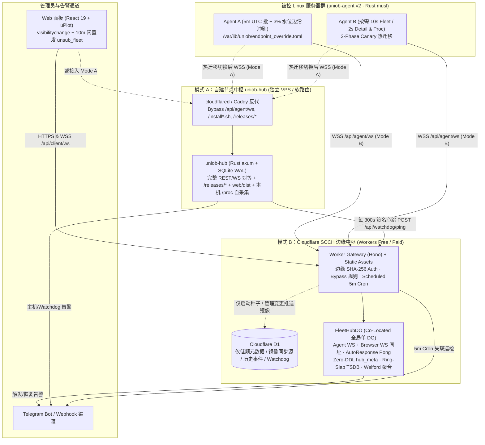
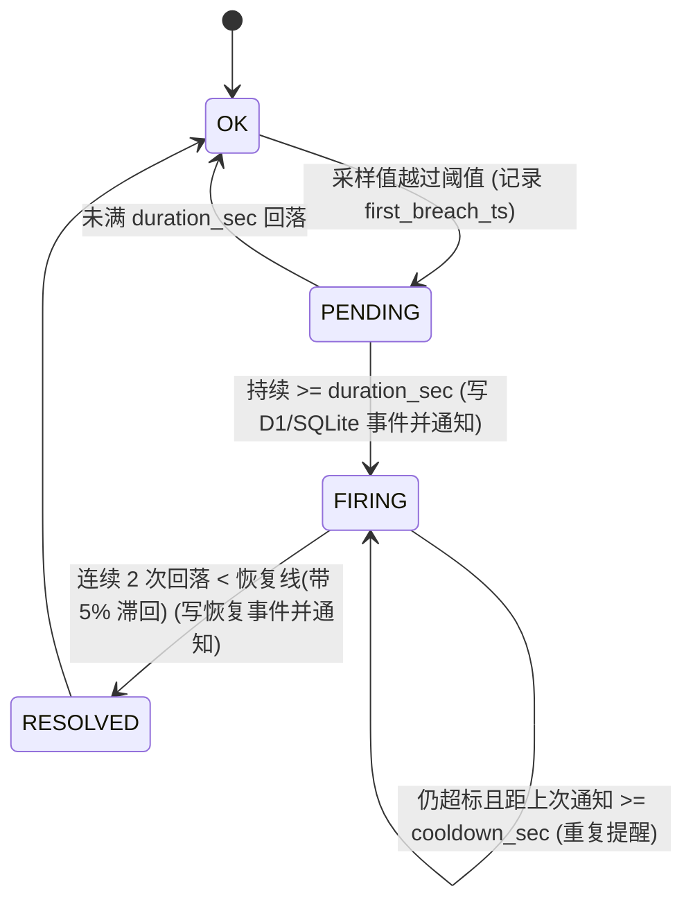

# UniOB (Unified Observability) 技术设计规范 (Technical Specification)

> 可选三网网络质量扩展见[功能规格](features/network-quality.md)与[实现契约](features/network-quality-contract.md)。

- **文档版本**：`v2.0.0`
- **目标场景**：多台 Linux 服务器（含 1G/2G 小内存 VPS）的安全只读监控、按需进程透视与实时告警系统
- **架构底座（Architecture v2）**：
  - **被控端**：纯静态 Rust `musl` 探针（`uniob-agent` v2，Protocol v2 批量与金丝雀热迁移）
  - **中心端双模对等**：
    - **方向 B（SCCH 边缘中枢）**：Cloudflare Workers + Static Assets + D1 + 同址单例 `FleetHubDO`（WebSocket Hibernation + Zero-DELETE Ring-Slab TSDB + Welford 流式聚合）
    - **方向 A（自建节点中枢）**：独立 Rust `uniob-hub`（`axum` + SQLite WAL + 本机 `/proc` Loopback 自采集）+ Cloudflare Workers Free 5 分钟 Cron 死开关看门狗

---

## 1. 设计目标与刚性约束 (Goals & Constraints)

### 1.1 核心目标
1. **极致轻量的被控端**：在 1GB RAM 低配 Linux VPS 上常驻内存（RSS）控制在 **3 MB ~ 6 MB**，静态二进制体积 **<= 2,621,440 字节（2.5 MB，Windows Release 实测 `1,498,112` B）**，静默巡航 CPU 占比接近 `0.0%`。
2. **绝对只读安全边界**：被控端无需开放任何入站端口（纯出站 `WSS 443`），下行控制帧仅允许固定枚举采样挡位（`0`/`1`/`2`）、水位阈值与经 HMAC-SHA256 验签的 `migrate` 目标地址；`systemd` 通过 `ProtectSystem=strict` + `NoNewPrivileges=true` + `MemoryMax=24M` 锁死权限边界，仅授权可写状态目录 `StateDirectory=uniob`（`/var/lib/uniob`）。
3. **降低 Cloudflare 运行开销（SCCH）**：通过同址单 DO、5m UTC 批量上报、冷唤醒 schema 门控、本地 D1 镜像与环形分块 TSDB，减少资源采集的持久化、跨实例通信和配置查询开销。部署容量按实际功能与负载核对账户配额。
4. **双模自由迁移与混合高可用（Direction A）**：随时可将全部节点密钥哈希、告警规则、通知渠道与月流量账本无损导出为状态 Bundle 并切换至任一自有 VPS 上的 `uniob-hub`，同时以极简 Cloudflare Workers Free Watchdog 解决“自建中枢自身断电/失联无人告警”盲区。
5. **准时且不扰民的告警**：原生利用状态机防抖、滞回恢复、维护静默及边缘水位瞬时冲刷，支持 Telegram Bot（含群组 Topic）与通用 Webhook 闭环通知。

### 1.2 明确不做的事（Non-Goals）
- **不做远程控制功能**：不包含 Web SSH、远程脚本下发、远程杀死进程（`kill`）、容器启停或文件管理。
- **不做高基数日志/APM 收集**：不采集全量业务日志文件或分布式调用链，聚焦主机与系统进程级可观测性。

---

## 2. 系统总体架构与运行成本

### 2.1 双模对等拓扑架构

UniOB v2 支持 **方向 B（Cloudflare SCCH 边缘同址中枢）** 与 **方向 A（自建 `uniob-hub` + Cloudflare 死开关看门狗）** 两种部署形态，并支持通过状态 Bundle 与 HMAC 金丝雀热迁移在两者间平滑切换：



> 注：历史兼容性类 [`NodeDO`](../worker/src/do/node-do.ts) 仍在 [worker/src/index.ts](../worker/src/index.ts) 与 [worker/wrangler.jsonc](../worker/wrangler.jsonc)（`v1` migration）中保留导出以维护存量部署迁移兼容；所有生产实时读写与聚合路由均已统一收口至 [`FleetHubDO`](../worker/src/do/fleet-hub-do.ts)。

### 2.2 方向 B（SCCH — Synchronized Cohort Co-Located Hibernation）6 大核心机制

1. **Co-Located 单 DO 同址汇聚（`FleetHubDO`）**：将所有 Agent WebSocket 与管理员 Browser WebSocket 汇聚至同一全局单例 `FleetHubDO`（`getByName("global")`），在同一 V8 Isolate 内存空间中完成采样帧接收、告警判定与前端广播（`fleet_batch` / `fleet_tick` / `node_detail`），彻底消灭 `NodeDO ↔ FleetHubDO` 双向跨 DO RPC（**`0` 跨 DO RPC**），并将整个机群的实例内存计费收敛为 **`1 × 128 MB`**。
2. **`setWebSocketAutoResponse` + `< 512 B` 紧凑 Attachment**：在 `FleetHubDO` 构造函数中注册 `ctx.setWebSocketAutoResponse(new WebSocketRequestResponsePair('{"op":"ping"}', '{"t":"pong"}'))`；浏览器每 `25s` 心跳与探针每 `20s` RFC 6455 Ping/Pong 均由 Cloudflare 边缘自动回复，**0 次 DO 请求、0 GB-s 唤醒计费**。Agent/Client attachment 字段高度精简并严格控制在 `< 512 B`（远低于 `2,048 B` Hibernation 限制）。
3. **UTC 相位锁定 `5m` Cohort 批量帧（`mb`）+ 边缘水位即时冲刷**：
   - 静默态（`mode = 0`）下，探针每 `30s` 将 16 元紧凑数组 `CompactMetricTuple` 写入 12 槽位环形缓存，仅在 **UTC `5` 分钟整点 + `[0, 400)` ms 确定性哈希抖动** 时发一帧 `t = "mb"`（`288` 帧/节点/日，20:1 折算仅 **`14.4` DO 请求/节点/日**），将全集群冷唤醒高度对齐为每 `5` 分钟一次脉冲。
   - DO 通过 `ctrl.watermarks` 向探针下发启用中的 CPU / Steal / Mem / Swap / Disk 最小阈值；探针内置 `EdgeDetector`（带 `3%` 恢复滞回）、`|Δcpu| >= 35%` 突刺与重启检测（`curr_up < prev_up`），一旦命中立即发送 `reason = "edge"` 批帧，保证 **危急告警 `0s` 延迟**；查看历史 `1h` 曲线若尾点滞后 `> 35s`，DO 主动下发 `flush_now: true`（最多等待 `350ms`）实时拉齐。
4. **Zero-DDL 冷唤醒检查 + Push-Invalidated 本地 D1 镜像**：冷唤醒时检查 `sqlite_master` 与 `hub_meta(key = 'schema_version') >= '2'`，绕过重复 `CREATE TABLE` DDL；配置表（`nodes_mirror`、`alert_rules_mirror`、`channels_mirror`）仅首个生命周期按 `mirror_seeded` 从 D1 拉取一次，后续管理操作通过 RPC（`syncNodeConfig`、`refreshRulesAndChannels`）增量推送，**稳态与告警评估路径 `0` 次热路径 D1 查询**。
5. **Zero-DELETE Ring-Slab 分块环存 + Welford 在线流式聚合 + 惰性合表**：
   - [tsdb-slab.ts](../worker/src/do/tsdb-slab.ts) 以小端定长二进制 BLOB 存储三级环存块：`metrics_chunk_10m`（`144` 槽 × `600s` = `24h`，每点 `76 B`）、`metrics_5m_chunk_1h`（`720` 槽 × `3600s` = `30d`，每点 `88 B`）、`metrics_1h_chunk_1d`（`366` 槽 × `86400s` = `366d`，每点 `88 B`），以 `(node_id, slot)` 为冲突键，仅更新 `bucket_ts` 与 `payload` 覆盖过期槽，**`0` 次时序 `DELETE`**、**`0` 次 `SELECT ... GROUP BY` 扫描**。
   - `node_state` 单行整合了在线状态、快照、`welford_5m_json`、`welford_1h_json` 与月流量账本；高频 `mode = 1/2` 下仅当到达 `>= 30s` 落盘点、状态切换、跨账期/重启或未落盘流量增量 `>= 64 MiB`（`TRAFFIC_COALESCE_BYTES`）时写盘。
6. **事件驱动断连闹钟 + 4 挡自适应租约 + Page Visibility 生命周期**：无客户端、无在线节点时调用 `deleteAlarm()`（`0` 闹钟写）；存在在线节点时设 `SAFETY_ALARM_MS = 15m` 集群总兜底（`96` 次/集群/日）；仅在 `webSocketClose`/`webSocketError` 时精准设定 `60s`（`OFFLINE_THRESHOLD_SEC`）离线触发。前端 `useFleetSocket.ts` 在标签页隐藏（`visibilitychange`）、离开大盘或无操作超过 `10` 分钟后立即发 `unsub_fleet`，避免后台无效拉高采样频率。

### 2.3 资源写入模型与容量评估

资源监控 Idle 基线为 **888 行/节点/日**，条件是历史环槽已建立、每五分钟一次批量上报、无实时订阅。以 `N` 个符合该条件的节点估算，资源路径每天约写入 `888N` 行；启用三网后的写入、初始化、配置变更、告警、重连、强制刷新及集群闹钟应另计。SQLite 行数使用完成执行的 `rowsWritten`，包含相关索引写入。

实时看盘会提高上报频率，网络检测增加独立历史块与状态写入，历史查询还会消耗读取和计算。容量评估需同时覆盖 Worker/DO 请求、DO 计算时长、SQL 读写、存储及账户其他业务，分别测量 Idle、日常看盘和持续实时订阅。该资源基线不构成免费节点数或月账单承诺；套餐额度与价格以 [Cloudflare 官方计费](https://developers.cloudflare.com/durable-objects/platform/pricing/) 为准。

自建 `uniob-hub` 将资源与网络历史写入本机 SQLite，不使用 DO 存储。若启用外部 Watchdog，默认每五分钟一次心跳与巡检，共约 576 次请求/天，云端配置查询、状态和通知另计；自建服务器资源也需独立评估。

---

## 3. 通信协议与安全规范 (Protocol v2 & Security Spec)

### 3.1 鉴权体系
1. **探针接入鉴权 (`Agent -> Edge/Hub`)**
   - 节点注册生成 `node_id`（`nd_<ulid>`）与 32 字节随机密钥 `agent_token`（`uob_live_...`），后端仅存 `SHA-256(agent_token)` 哈希（`token_sha256`）。
   - `GET /api/agent/ws` 通过请求头 `X-UniOB-Node-Id`（兼容 `?id=` query）与 `Authorization: Bearer <token>` 鉴权；Worker 在 `verifyAgentEdgeAuth` 中使用 isolate 内存 LRU 缓存命中，非法请求直接边缘 `401`，不唤醒 `FleetHubDO`。
2. **管理员面板鉴权 (`Browser -> Edge/Hub`)**
   - **内置模式（`builtin`）**：首次打开配置管理员密码（PBKDF2-HMAC-SHA256）或注入环境变量 `ADMIN_PASSWORD_HASH`（64 位 hex），签发 `HttpOnly; SameSite=Strict` 的 HMAC-SHA256 会话 Cookie（`uniob_session`，7 天有效期），含 5 分钟内连续失败 5 次触发 `429` 限流。
   - **Cloudflare Access 模式（`cf_access`）**：`Fail-Closed` 强制核验 `Cf-Access-Jwt-Assertion` RS256 JWKS 签名与 `CF_ACCESS_ALLOWED_EMAILS`（Worker 与自建 `uniob-hub` 双端同构支持）。
3. **热迁移与 Watchdog HMAC 鉴权**
   - 热迁移：`HMAC-SHA256(key = UTF8(lowercase(token_sha256)), msg = "${node_id}:${epoch}:${ws_url}")`；禁止私有/回环网段 SSRF，生产 `cf_access` 模式下禁止 `ws://`。
   - Watchdog 心跳：`X-Watchdog-Timestamp` 与 `X-Watchdog-Signature = HMAC-SHA256("${ts}:${rawBody}", secret)`，要求时钟偏差 `<= 300s`，常量时间比对。

### 3.2 Agent ↔ 中枢 WebSocket 协议 v2 (`/api/agent/ws`)

#### 3.2.1 握手帧 (`t = "hello"`, `v = 2`)
```json
{
  "t": "hello",
  "v": 2,
  "capabilities": ["mb_v2", "migrate_v1"],
  "migrated_epoch": 1763128000,
  "agent_ver": "0.1.0",
  "hostname": "hk-bgp-nano-01",
  "os": "Debian GNU/Linux 12 (bookworm)",
  "kernel": "6.1.0-26-amd64",
  "arch": "x86_64",
  "cpu_model": "AMD EPYC 7763 64-Core Processor",
  "cpu_cores": 1,
  "mem_total": 1020264448,
  "swap_total": 1073737728,
  "boot_time": 1762001234,
  "proc_enabled": true
}
```
> 兼容老版 `v = 1` 探针降级回单帧 `m` 与 30s 静默模式；只要探针当前通过热迁移覆盖端点（`endpoint_override`）建立连接，握手均携带 `migrated_epoch`。

#### 3.2.2 批量指标帧 (`t = "mb"`, `v = 2`) —— 静默巡航与边沿冲刷核心帧
Idle (`mode = 0`) 下探针每 30s 采集一次放入 12 槽环存，到达 5 分钟 UTC 整点（加 `[0, 400)` ms 确定性节点哈希抖动）或命中边沿触发条件时一次性发送 `mb`：

```json
{
  "t": "mb",
  "v": 2,
  "reason": "cohort",
  "pts": [
    [1763127900, 1126736, 12.1, 0.5, 0.2, 0.14, 410123776, 12582912, 6421980000, 0, 4096, 102400, 204800, 84919000000, 192837000000, 22]
  ],
  "last": {
    "ts": 1763128200,
    "up": 1127036,
    "cpu": { "all": 14.2, "cores": [14.2], "steal": 0.8, "iowait": 0.3, "load": [0.18, 0.12, 0.09] },
    "mem": { "used": 412876800, "avail": 607387648, "cached": 289406976, "swap_used": 12582912 },
    "disks": [{ "mp": "/", "fs": "ext4", "total": 21002936320, "used": 6421987328, "r_bps": 0, "w_bps": 16384 }],
    "net": { "rx_bps": 128450, "tx_bps": 349120, "rx_tot": 84920193842, "tx_tot": 192837465120, "tcp_est": 24, "tcp_tw": 11, "udp": 4 }
  }
}
```
- **`reason` 枚举**：`"cohort"`（UTC 5m 相位批）、`"edge"`（水位越界 / `|Δcpu| >= 35%` / 重启）、`"flush"`（响应 `ctrl.flush_now` 或从 `mode = 0` 切向实时挡位）、`"hello"`（握手附带缓存点）。
- **`CompactMetricTuple`（严格 16 项数值元组）**：
  `[0:ts, 1:up, 2:cpu_all, 3:steal, 4:iowait, 5:load1, 6:mem_used, 7:swap_used, 8:disk_used, 9:disk_r_bps, 10:disk_w_bps, 11:net_rx_bps, 12:net_tx_bps, 13:rx_tot, 14:tx_tot, 15:tcp_est]`。

#### 3.2.3 周期单帧 (`t = "m"`) —— 实时模式 (`mode = 1 | 2`) 与 v1 兼容
结构沿用实时完整指标负载（含 `ts`, `up`, `cpu`, `mem`, `disks`, `net`, 可选 `procs`）。仅当 `mode = 2`（Live Proc）且本地 `process.enabled = true` 时携带 `procs` Top-N 数组；其余模式一律省略。

#### 3.2.4 下行控制帧 (`t = "ctrl"`) —— 四挡自适应与热迁移
```json
{
  "t": "ctrl",
  "mode": 1,
  "interval_ms": 10000,
  "batch_sec": 300,
  "top_n": 0,
  "lease_sec": 90,
  "flush_now": false,
  "watermarks": { "cpu": 90, "steal": 20, "mem": 90, "disk": 90 },
  "migrate": {
    "url": "wss://hub.example.com/api/agent/ws",
    "fallback_url": "wss://monitor.example.com/api/agent/ws",
    "epoch": 1763128500,
    "sig": "<64-char-hmac-sha256-hex>"
  }
}
```
- **中心端 4 挡控制参数（`computeCtrlForNode`）**：
  | 活跃状态 | `mode` | `interval_ms` | `batch_sec` | `top_n` | `lease_sec` | 说明 |
  | :--- | :--- | :--- | :--- | :--- | :--- | :--- |
  | **Idle**（无在线订阅） | `0` | `30000` | `300`（v2） | `0` | `0` | UTC 5m `mb` 批发送，附带 `watermarks` |
  | **Fleet Pulse**（总览页直播） | `1` | `10000` | — | `0` | `90` | 大盘 10s 级刷新，降载不推进程表 |
  | **Node Detail**（单机抽屉图表） | `1` | `2000` | — | `30` | `90` | 单机 2s 高频推流 |
  | **Live Proc**（单机进程页签） | `2` | `2000` | — | `30` | `90` | 单机 2s + Top 30 脱敏进程透视 |
- **探针侧防御性钳制**：`CtrlFrame::clamped()` 将 `interval_ms` 钳制在 `[1000, 60000]` 毫秒，在 `mode = 0` 下允许 `top_n ∈ [0, 50]`、`lease_sec ∈ [0, 180]`，在 `mode > 0` 下钳制 `top_n ∈ [5, 50]`、`lease_sec ∈ [30, 180]`；`batch_sec` 由 `CollectorScheduler::apply_ctrl` 钳制在 `[30, 3600]` 秒；租约超时自动回退 `mode = 0`。

### 3.3 管理员 Browser ↔ 中枢 WebSocket 协议 (`/api/client/ws`)

- **AutoResponse Ping/Pong 与 50s 续约 (`renew`)**：浏览器每 `25s` 发送 `{"op":"ping"}`，CF 边缘直接零成本返回 `{"t":"pong"}`（`0` DO 请求、`0` 唤醒时长）；当且仅当标签页可见、非闲置且存在活跃订阅（`sub_fleet` 或 `sub_node`）时，浏览器每 `50s` 发送 `{"op":"renew"}` 将当前订阅 `att.exp` 顺延 `90s`（不重发 `fleet_batch` 也不重复下发 `ctrl`）。
- **上行订阅指令**：`sub_fleet`（开启 90s 总览租约并回发 `fleet_batch`）、`unsub_fleet`（立即退出总览订阅并重算探针挡位）、`sub_node`（`{ nodeId, proc: boolean }`）、`unsub_node`、`renew`（仅续期活跃订阅）。
- **下行推送消息**：`fleet_batch`（`{ t: "fleet_batch", ticks: FleetTickMessage[] }`）、`fleet_tick`、`node_detail`、`node_offline`、`alert_change`。

---

## 4. Rust 极轻探针规范 (`uniob-agent`)

### 4.1 运行时、纯 Rust 密码学与瘦身约束
- **零外部加密/异步大依赖**：保留单 OS 线程 `std::net::TcpStream` + `tungstenite` + `rustls` 模型；[agent/src/crypto.rs](../agent/src/crypto.rs) 纯手工实现通过 FIPS 180-4 & RFC 4231 Test Cases 1–7 验证的 `sha256`、`hmac_sha256_hex` 与常量时间比较 `constant_time_eq`，未向 `agent/Cargo.toml` 新增任何 crate。
- **`Cargo.toml` 发布约束**：`opt-level = "z"`, `lto = true`, `codegen-units = 1`, `panic = "abort"`, `strip = "symbols"`；CI 与本地强制检验 `<= 2,621,440` B（当前 Windows Release 为 `1,498,112` B ≈ `1.43 MiB`）。

### 4.2 Linux `/proc` 零子进程采集与 5m Cohort 调度
1. **CPU / 内存 / 磁盘 / 网络 / 进程采集规则**：严禁 `fork/exec`；CPU `total` 仅累加前 8 项（`user+nice+system+idle+iowait+irq+softirq+steal`）；`/proc/net/sockstat` O(1) 提取 TCP/UDP；两阶段按需进程扫描（仅对 CPU Top-N ∪ RSS Top-N 读取 `/proc/[pid]/cmdline`）。
2. **12 槽位环形缓存与 UTC 5m 相位锁定（`agent/src/collector/mod.rs`）**：
   - `AgentCollector` 维护容量 `12` 的 `VecDeque<CompactMetricTuple>`。
   - **相位锁定抖动**：下一次批冲刷目标计算为下一个 `300s` UTC 整点偏移 `deterministic_hash_jitter(node_id)`（范围 `[0, 400) ms`），将全机群唤醒严格收敛进半秒窗口。
3. **`EdgeDetector` 水位与边沿突变检出**：
   - 追踪 `cpu`, `steal`, `mem`, `swap`, `disk` 上下阈值与 **`3%` 恢复滞回**，叠加瞬时跳变 `|Δcpu| >= 35.0%` 与重启检查（`curr_up < prev_up`）；任一触发均立即发送 `reason = "edge"` 的 `mb` 帧；由 `mode = 0` 切换为 `1|2` 或收到 `flush_now = true` 时立即冲刷缓冲区。

### 4.3 `cmdline` 配置开关与无正则脱敏规范

探针配置文件 `/etc/uniob/agent.toml`（CLI 支持 `-c`/`--config`、`--state-dir`、`--allow-insecure-ws-for-test`、`--once`、`-V`/`--version`、`-h`/`--help`）：

```toml
[server]
url = "wss://monitor.example.com/api/agent/ws"
node_id = "nd_01j8x9k2m4p5q6r7s8t9v0w1x2"
token = "uob_live_xxxxxxxxxxxxxxxxxxxxxxxxxxxxxxxx"

[collector]
nic_allowlist = []
mount_ignore_prefixes = ["/snap", "/boot/efi", "/run"]

[process]
enabled = true
# "sanitized" (默认推荐) | "comm_only" | "full"
cmdline_mode = "sanitized"
```

#### `sanitized` 模式词法脱敏规则（零正则依赖手写扫描器）
对以 `\0` 分隔的原始 `argv` 数组逐项扫描：
1. **独立敏感参数名**：`argv[i]`（去掉前导 `-` 且大小写不敏感）匹配 `p | pass | passwd | password | token | secret | api-key | apikey | access-key | secret-key | auth | bearer | credential | private-key` 时替换 `argv[i+1]` 为 `***`，并兼容紧凑写法 `-pSecret` -> `-p***`。
2. **键值对参数（`--key=value` / `KEY=value`）**：`key` 含 `pass | pwd | token | secret | key | auth | cred | cookie | dsn | jwt` 时输出 `key=***`。
3. **URI 凭证串**：`://` 且首个 `/` 前含 `user:password@host` 时替换密码为 `***`。
4. **长度截断**：总长超 `256` 字符截断并追加 `…`。

### 4.4 热迁移状态机 (`agent/src/migrate.rs`) 与 `systemd` 加固
- **持久化覆盖**：状态保存在 `--state-dir` 下的 `endpoint_override.toml`（默认 `/var/lib/uniob/endpoint_override.toml`），原子写入失败（如只读测试容器）时退化为内存生效而不崩溃。
- **双阶段金丝雀握手与自动回退**：收到合法 `migrate` 指令（`epoch > last_applied_epoch`、`abs(now - epoch) <= 600s`、SSRF 校验通过、HMAC 验证通过）后：
  1. 保持旧 WS 会话继续心跳不中断，新建 TLS/WS 连接向目标发送 `hello` 并限定 **`10s` 内（`CANARY_CTRL_TIMEOUT`）** 收到首帧 `ctrl`；失败则丢弃试探连接、保留旧中枢。
  2. 金丝雀成功后原子写入 `endpoint_override.toml`（含 `primary_url`, `fallback_url`, `applied_epoch`）并立即切流至新连接。
  3. 若切流后新中枢连续失联 **`>= 300s`（`DEAD_HUB_MAX_ELAPSED`）或重试 `>= 10` 次（`DEAD_HUB_MAX_RETRIES`）**，`MigrationState` 自动恢复连接 `fallback_url`。
- **`systemd` 服务沙箱（`scripts/install.sh.tmpl`）**：
  ```ini
  [Service]
  User=nobody
  Group=nogroup
  NoNewPrivileges=true
  ProtectSystem=strict
  ProtectHome=read-only
  PrivateTmp=true
  StateDirectory=uniob
  StateDirectoryMode=0750
  MemoryMax=24M
  Restart=always
  RestartSec=3
  ```

---

## 5. Cloudflare 中心端规范 (`uniob-worker`)

### 5.1 `wrangler.jsonc` 配置规范

```jsonc
{
  "$schema": "./node_modules/wrangler/config-schema.json",
  "name": "uniob",
  "main": "src/index.ts",
  "compatibility_date": "2026-11-01",
  "assets": {
    "directory": "../web/dist",
    "binding": "ASSETS",
    "not_found_handling": "single-page-application",
    "run_worker_first": ["/api/*", "/install.sh", "/install-hub.sh"]
  },
  "d1_databases": [
    {
      "binding": "DB",
      "database_name": "uniob-meta",
      "database_id": "<YOUR_D1_DATABASE_ID>"
    }
  ],
  "durable_objects": {
    "bindings": [
      { "name": "NODE_DO", "class_name": "NodeDO" },
      { "name": "FLEET_HUB_DO", "class_name": "FleetHubDO" }
    ]
  },
  "migrations": [
    {
      "tag": "v1",
      "new_sqlite_classes": ["NodeDO", "FleetHubDO"]
    }
  ],
  "triggers": {
    "crons": ["*/5 * * * *"]
  },
  "observability": {
    "logs": { "enabled": true, "head_sampling_rate": 0.05, "invocation_logs": true, "persist": true },
    "traces": { "enabled": false }
  }
}
```

### 5.2 Cloudflare D1 全局关系表结构 (`migrations/0001_init.sql`)
包含 `nodes`、`notification_channels`、`alert_rules`、`alert_incidents` 与 `system_settings`（保存管理员认证密文、会话密钥及 Watchdog 的 `watchdog_config`/`watchdog_state`）：
- `nodes`：`id`, `name`, `group_name`, `tags_json`, `sort_order`, `token_sha256`, `traffic_limit_bytes`, `traffic_reset_day`, `traffic_count_mode`, 硬件快照字段, `mute_until`, `created_at`, `updated_at`。
- `notification_channels`：`id`, `name`, `type` (`'telegram' | 'webhook'`), `enabled`, `config_json`, `created_at`。
- `alert_rules`：`id`, `name`, `node_id` (`NULL` = 全局), `metric` (`'offline' | 'cpu' | 'steal' | 'mem' | 'swap' | 'disk' | 'traffic_pct'`), `operator` (`'gt' | 'gte'`), `threshold`, `duration_sec`, `cooldown_sec`, `channel_ids_json`, `enabled`, `created_at`。
- `alert_incidents` & `system_settings`：`alert_incidents` 记录历史事件与耗时，`system_settings (key PRIMARY KEY, value, updated_at)` 存储系统及 Watchdog 配置。

### 5.3 `FleetHubDO` SQLite 表设计与 Ring-Slab 二进制格式

`FleetHubDO` 内部仅维护 9 张轻量表（由 `hub_meta(key = 'schema_version') = '2'` 门控一次建表，冷启动零重复 DDL）：
1. **本地镜像与状态**：`hub_meta`、`nodes_mirror`、`alert_rules_mirror`、`channels_mirror`、`node_state`（含单行聚合列 `last_seen_ts`, `last_raw_ts`, `online`, `cycle_key`, `last_agent_rx`, `last_agent_tx`, `cycle_rx_bytes`, `cycle_tx_bytes`, `last_boot_up`, `last_metrics_json`, `welford_5m_json`, `welford_1h_json`）、`alert_rule_states`。
2. **Ring-Slab 环形时序块表 (`(node_id, slot) PRIMARY KEY`)**：
   - `metrics_chunk_10m`：`RAW_CHUNK_SEC = 600`，`144` 槽（24h 滚动覆盖），`RAW_STRIDE = 76` 字节/点（Little-Endian `ts` + `12` 个紧凑数值）。服务 `GET /api/nodes/:id/metrics?range=1h`（滞后 `> 35s` 先下发 `flush_now` 等候最多 `350ms`）。
   - `metrics_5m_chunk_1h`：`ROLLUP_5M_SEC = 300`, `CHUNK_5M_SEC = 3600`, `720` 槽（30d），`ROLLUP_STRIDE = 88` 字节/点（均值 + 峰值）。服务 `range = 24h | 7d | 30d`。
   - `metrics_1h_chunk_1d`：`ROLLUP_1H_SEC = 3600`, `CHUNK_1H_SEC = 86400`, `366` 槽（366d），`ROLLUP_STRIDE = 88` 字节/点。服务 `range = 1y`。

### 5.4 REST API 与安装分发接口一览

| 方法与路径 | 鉴权方 | 说明 |
| :--- | :--- | :--- |
| `GET /api/health` | 公开 | 网关健康检查 |
| `GET /api/auth/me` / `status` / `POST setup, login, logout` | 公开 / Admin | 管理员会话认证与 CF Access 状态识别 |
| `GET /api/agent/ws` | Agent Bearer | 探针 WebSocket 升级（边缘 SHA-256 拦截后转入 `FleetHubDO`） |
| `GET /api/client/ws` | Admin | 浏览器复用长连接 |
| `GET / POST /api/nodes`, `GET / PATCH / DELETE /api/nodes/:id` | Admin | 节点管理与硬件/配置同步（变更主动推送 `FleetHubDO` 镜像） |
| `POST /api/nodes/:id/rotate-token` / `mute` | Admin | 密钥轮换踢线 / 维护静默 |
| `GET /api/nodes/:id/metrics?range=1h\|24h\|7d\|30d\|1y` | Admin | 从环形块与 Welford 状态无缝解包历史曲线 |
| `GET / POST / PATCH / DELETE /api/alerts/{channels,rules}` & `test` & `presets` | Admin | 通知渠道、告警规则（改后广播刷新 `FleetHubDO` 镜像与下发新水位） |
| `GET /api/alerts/incidents` | Admin | 分页告警历史查询 |
| `GET /api/hub/status` | Admin | 查询当前中枢模式（`cloudflare-worker` / `self-hosted-hub`）、在线探针与 Watchdog 摘要 |
| `GET /api/export/bundle` | Admin | 导出便携 JSON Bundle（含 `nodes`+`token_sha256`、`channels`、`rules`、`traffic_ledgers`、`settings`，剔除 `watchdog_state`） |
| `POST /api/import/bundle` | Admin | 事务级幂等导入 Bundle 并刷新 `FleetHubDO`（或本地 SQLite）状态 |
| `POST /api/hub/migrate` | Admin | 生成并发起全量或指定 `node_ids` 的 HMAC 签名金丝雀热迁移 |
| `GET / PUT /api/watchdog/config` | Admin | 读取/保存 Watchdog 开关、Secret 轮换、超时与冷却配置（Worker 侧） |
| `POST /api/watchdog/ping` | Watchdog HMAC | 接收自建中枢 5 分钟签名存活心跳（`±300s` 防重放） |
| `GET /install.sh` & `GET /install-hub.sh` | 公开脚本 | 动态渲染探针与 `uniob-hub` 的 `systemd` 一键安装脚本 |
| `GET /releases/*` | 公开（自建 Hub） | `uniob-hub` 本地预缓存的 `uniob-agent-*` 与校验文件分发端点 |

---

## 6. 告警引擎、Telegram Bot 与 Cloudflare 外部看门狗

### 6.1 告警判定状态机（内置于 `FleetHubDO` 与 `hub/src/alerts.rs`）


- **事件驱动断连看门狗**：当代理断开 TCP/WSS 时 `webSocketClose`/`webSocketError` 设 `offline_deadline_ms = now + 60,000ms` 精准闹钟（`OFFLINE_THRESHOLD_SEC = 60`）；若存在已连接的 `v >= 2 && mode === 0` 探针 socket（5 分钟 `mb` 静默批期 + 边缘免费 RFC 6455 Ping 不唤醒 DO），`alarm()` 使用 `COHORT_OFFLINE_THRESHOLD_SEC = 390`（`300s + 90s` 宽限）避免误报假离线，断连、`v1` 与实时模式仍维持 `60s`；正常在线时仅依托 `15m` 集群总安全兜底。

### 6.2 Telegram Bot 与 Webhook 推送
支持 Telegram `sendMessage`（`parse_mode: "HTML"`，可选 `message_thread_id`）及通用 JSON Webhook（3 次指数退避重试）；`mute_until > now` 期间正常留痕抑制外推。

### 6.3 Cloudflare 外部死开关看门狗 (`worker/src/watchdog.ts` & `hub/src/watchdog.rs`)
- **防失联盲区**：`uniob-hub` 后台任务每 `watchdog_interval_sec`（默认 `300s`）采集自身健康摘要（`hub_label`, `version`, `connected_agents`, `total_nodes`）POST 至 Worker `/api/watchdog/ping`。
- **Cron 巡检 (`scheduled()`)**：Worker 每 5 分钟执行 `runWatchdogCron`；若开启且 `now - last_ping_ts > timeout_sec`（Worker 默认 `180s`，UI 推荐设为 `900s` 留足 3 次心跳容错）且满足 `cooldown_sec`（默认 `1800s`），由 Cloudflare 边缘节点独立发出 `FIRING` 失联告警；恢复首次心跳抵达时即发 `RESOLVED` 恢复通知。

---

## 7. 方向 A：自建节点中枢规范 (`hub/` — `uniob-hub`)

- **工程结构（`hub/`）**：独立 `Cargo.toml`（Windows Release 二进制实测 `4,070,400` B），包含 `config.rs`, `db.rs`, `auth.rs`, `crypto.rs`, `protocol.rs`, `traffic.rs`, `alerts.rs`, `hub_state.rs`, `routes.rs`, `self_probe.rs`, `watchdog.rs`, `install_scripts.rs`。
- **本地 SQLite WAL 与二进制存储**：[hub/src/db.rs](../hub/src/db.rs) 打开 `WAL + NORMAL + busy_timeout=5000 + foreign_keys=ON`，同构实现 11 张表（`nodes`、`notification_channels`、`alert_rules`、`alert_incidents`、`system_settings`、`traffic_ledgers`、`node_state`、`metrics_chunk_10m` [`96 B`/点]、`metrics_5m_chunk_1h` [`104 B`/点]、`metrics_1h_chunk_1d`、`alert_rule_states`），以 `imported_bundle_sha256` 保证启动 `--import-bundle` 幂等。
- **宿主机 `/proc` Loopback 自采集（`hub/src/self_probe.rs`）**：中枢自带轻量周期采集器，跳过网络直接喂入 `HubState` 与本地环存表（默认节点 ID `hub-local` / 名称 `Hub Local`），同样受限于脱敏和阈值配置。
- **TOML 配置示例（`/etc/uniob-hub/hub.toml`）**：
  ```toml
  [server]
  listen = "127.0.0.1:8787"
  db_path = "/var/lib/uniob-hub/uniob.db"
  web_dir = "/usr/local/share/uniob-hub/web"
  releases_dir = "/usr/local/share/uniob-hub/releases"
  public_url = "https://hub.example.com"

  [auth]
  mode = "builtin" # 或 "cf_access" 并配置 cf_access_team_domain / cf_access_aud / cf_access_allowed_emails

  [self_probe]
  enabled = true
  node_id = "hub-local"
  node_name = "Hub Local"

  [watchdog]
  url = "https://monitor.example.com/api/watchdog/ping"
  secret = "<watchdog-hmac-secret>"
  interval_sec = 300
  ```
- **Access Bypass 清单**：使用 Cloudflare Tunnel 反代本地 `127.0.0.1:8787` 时，必须在 Access 中为 `/api/agent/ws`、`/install.sh`、`/install-hub.sh`、`/releases/*` 以及 Worker 看门狗域名 `/api/watchdog/ping` 建立最高优先级 `Bypass` 放行规则。

---

## 8. Web 前端面板规范 (`uniob-web`)

- **技术栈**：React 19 + TypeScript + Vite + TailwindCSS v4 + `uPlot`（Canvas 2D，~45 KB）+ `lucide-react`。
- **前端节流与可见性生命周期（`web/src/hooks/useFleetSocket.ts`）**：
  - 仅当当前路由为大盘（`route === "dashboard"`）、`document.visibilityState === "visible"` 且未超时（`IDLE_TIMEOUT_MS = 10 * 60 * 1000`）时发送 `sub_fleet`；一旦切换标签页隐藏、离开总览页或闲置超过 10 分钟立即发送 `unsub_fleet` 并暂停心跳，重回前台毫秒级无缝续订与 `fleet_batch` 全量刷新。
  - 心跳固定每 `25s` 发送 `{"op":"ping"}`（命中 CF AutoResponse 零成本保活），且仅在存在活跃订阅时每 `50s`（`LEASE_RENEW_INTERVAL_MS = 50000`）发送 `{"op":"renew"}` 维持 90s 订阅租约，标签页隐藏或无活跃订阅时立即停发。
- **中枢模式与热迁移控制台（`web/src/components/HubMigrationPanel.tsx`）**：
  - 实时展现当前后端身份（`cloudflare-worker` / `self-hosted-hub`）、在线连接探针数与 Watchdog 状态胶囊；
  - 提供一键下载 `uniob-bundle-<date>.json` 与浏览器选择文件导入；
  - 动态生成带可选项的 `curl ... /install-hub.sh` 安装指令（含 `cloudflared` 提示）；
  - 提供金丝雀探针热迁移表单（支持全量或指定节点、非生产回退校验 `allow_insecure_ws`）与 Cloudflare Watchdog 开关/超时/Secret 管理及中枢 CLI 启动指令片段。

---

## 9. Monorepo 目录结构与验证结果汇总

```text
UniOB/
├── docs/SPEC.md                          # v2.0.0 完整技术设计规范与资源成本模型
├── docs/ARCHITECTURE.md                  # 架构演进记录、SCCH / 双模中枢与智能迁移协议
├── docs/API.md                           # 全量 HTTP REST 与 WebSocket 协议参考
├── README.md                             # 双模部署、Access Bypass、CI 与本地联调说明
├── package.json                          # typecheck / build:web / test:agent / test:hub / test:worker / build:*
├── agent/
│   ├── Cargo.toml
│   └── src/
│       ├── main.rs                       # CLI (--state-dir, --allow-insecure-ws-for-test)、2阶段 Canary、Dead-Hub 回退
│       ├── crypto.rs                     # 纯 Rust SHA-256 + HMAC-SHA256 + constant_time_eq
│       ├── migrate.rs                    # endpoint_override.toml 持久化、epoch/HMAC/SSRF 防护、自动回退状态机
│       ├── protocol.rs                   # Hello v2, CompactMetricTuple(16), MetricsBatchFrame, CtrlFrame v2
│       ├── config.rs & sanitize.rs
│       └── collector/{mod.rs,cpu.rs,mem.rs,disk.rs,net.rs,proc.rs}
├── hub/
│   ├── Cargo.toml & Cargo.lock
│   ├── src/
│   │   ├── lib.rs & main.rs              # axum 启动入口、CLI (--import-bundle, --import-only, --watchdog-*)
│   │   ├── config.rs & crypto.rs & protocol.rs & traffic.rs
│   │   ├── db.rs                         # SQLite WAL + 11 表同构 + Ring-Slab + Bundle 幂等导入导出
│   │   ├── auth.rs & alerts.rs & hub_state.rs & routes.rs
│   │   ├── self_probe.rs                 # 本机 /proc 零网络 Loopback 自采集
│   │   ├── watchdog.rs                   # 定时 HMAC 签名上报至 CF Watchdog
│   │   └── install_scripts.rs
│   └── tests/e2e.rs
├── worker/
│   ├── wrangler.jsonc & vitest.config.ts
│   ├── migrations/0001_init.sql
│   ├── src/
│   │   ├── index.ts                      # Hono 路由、Direction A 控制面、exported fetch & scheduled()
│   │   ├── auth.ts & crypto.ts & traffic.ts & types.ts & install-script.ts
│   │   ├── migration.ts                  # URL 规范化、SSRF 防护与探针热迁移 HMAC 签发
│   │   ├── watchdog.ts                   # Watchdog 配置/签名心跳接收/Cron 巡检
│   │   ├── do/{fleet-hub-do.ts,tsdb-slab.ts,node-do.ts}
│   │   └── alert/{engine.ts,telegram.ts}
│   └── test/{auth,direction-a,fleet-hub,install-script,node-do,nodes-api}.test.ts
├── web/
│   ├── package.json & vite.config.ts
│   └── src/
│       ├── App.tsx & types.ts & api/client.ts
│       ├── hooks/useFleetSocket.ts       # 可见性/闲置退订 + 25s ping + fleet_batch 合并
│       ├── components/{HubMigrationPanel.tsx,FleetGrid,FleetTable,NodeDrawer,ProcessTable,TimeChart...}
│       └── pages/{Dashboard,NodesManage,AlertsConfig,Login}
├── scripts/
│   ├── install.sh.tmpl                   # 含 StateDirectory=uniob 加固探针安装模板
│   └── install-hub.sh.tmpl               # 自建中枢 uniob-hub systemd 一键安装/Bundle 迁移模板
└── .github/workflows/
    ├── ci.yml                            # Web / Worker / Agent / Hub 持续集成检查
    ├── release.yml                       # Release: Web 打包 + Agent/Hub 双架构 musl 编译发布
    └── deploy-cloudflare.yml             # 可选 GitHub Actions 自动化部署至 Cloudflare Workers
```

### 已完成里程碑与构建测试基线
- **Milestone 1–4（v1 基线）**：[x] 完成 Rust `/proc` 探针、`cmdline` 脱敏、Worker + D1 + WebSocket Hibernation + React `uPlot` 面板 + Telegram/Webhook 告警闭环。
- **Milestone 5（方向 B — SCCH 边缘降本重构）**：[x] `FleetHubDO` 同址收敛、`tsdb-slab.ts` Zero-DELETE 环存、Welford 在线聚合、`mb` 5m 相位批量 + 水位边沿冲刷、`setWebSocketAutoResponse`、Zero-DDL 冷唤醒、Push-Invalidated D1 镜像、`useFleetSocket` 可见性与闲置自动 `unsub_fleet`。
- **Milestone 6（方向 A — `uniob-hub`、热迁移与混合看门狗）**：[x] 独立 `hub/` crate、`self_probe`、`/api/export/bundle` & `/api/import/bundle`、`/api/hub/migrate` HMAC 双阶段金丝雀迁移 + `StateDirectory=uniob` + 自动回退、CF Cron 死开关 Watchdog、`install-hub.sh.tmpl` 及 `HubMigrationPanel.tsx` UI 上线。
- **实测验证结果**：
  - `cargo test --manifest-path agent/Cargo.toml`：`55 passed; 0 failed`（覆盖纯 Rust SHA-256/HMAC、12 槽环存、UTC 5m 抖动、水位/突变边沿检测、SSRF/防重放/金丝雀/自动回退）
  - `cargo build --release --manifest-path agent/Cargo.toml`：`uniob-agent.exe` `1,498,112` 字节（满足 `<= 2,621,440` B 刚性红线）
  - `cargo test --manifest-path hub/Cargo.toml`：`21 passed; 0 failed`（19 单测 + 2 端到端集成测试）
  - `cargo build --release --manifest-path hub/Cargo.toml`：`uniob-hub.exe` `4,070,400` 字节
  - `npm run typecheck:worker` & `npm run test:worker`：`7` 个测试文件 `32 passed (32)`
  - `npm run typecheck:web` & `npm run build:web` & `bash -n scripts/*.tmpl`：全部 `exit 0` 通过。
