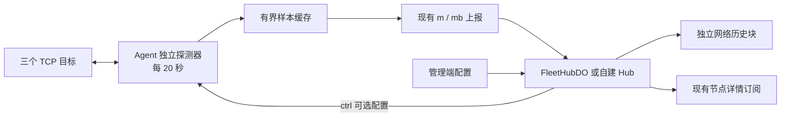

# 三网网络质量检测：功能规范

- **协议**：具体字段见[实现契约](network-quality-contract.md)。
- **编写日期**：2026-11-15。
- **功能目标**：在 UniOB 的节点详情中查看服务器到电信、联通、移动目标的 TCP 建连延迟、探测失败率及历史走势；支持管理端配置目标，Cloudflare 与自建 Hub 行为一致。
- **相关规范**：[总体设计](../SPEC.md)、[架构](../ARCHITECTURE.md)、[现有 API](../API.md)、[安全边界](../../SECURITY.md)。本文保留功能设计与验收要求，实际字段以实现契约为准。

## 1. 功能目标与首期范围

由每台服务器上的 `uniob-agent` 主动探测三个目标，中枢接收结果、保存历史并推送给网页。测量方向是“被监控服务器 → 配置的目标”；Cloudflare 和自建 Hub 不代替远程 Agent 发起探测。

首期必须完成：

1. 三个固定目标槽位 `ct`、`cu`、`cm`，分别预设电信、联通、移动；可分别停用或替换地址。
2. TCP 探测、明确的 IPv4 地址族、当前结果、最近 120 秒统计，以及 1 小时 / 24 小时 / 7 天 / 30 天历史。
3. 全局默认配置、单节点继承 / 自定义 / 关闭，以及无需重装 Agent 的配置下发。
4. 两种中枢接入、旧 Agent 兼容、配置备份与热迁移、关闭功能后的正常降级。
5. 自建 Hub 的 `hub-local` 本机节点使用同样的探测与统计语义，通过本地采集链路写入，不绕公网 WSS。

首期不包含 ICMP、IPv6 测量、HTTP 应用可用性、带宽测速、路由追踪、运营商线路评级、任意数量目标、网络质量通知告警或一年历史。保留扩展空间，但不要为了这些后续能力扩大首期实现。现有资源告警与离线告警继续按原逻辑工作。

**术语约定**：UI 使用“TCP 延迟”和“探测失败率”。TCP 连接失败可能由 DNS、连接拒绝、超时等原因引起，不能将这一比例宣称为链路逐包丢包率；目标的运营商与地区标签也不能代表该运营商所有用户的体验。

## 2. 默认目标、来源与选点

首期使用 [Zstatic 三网节点目录](https://www.zstaticcdn.com/) 的广东 IPv4 目标：

| 槽位 | 名称 | 地区 | host | port | address_family |
| --- | --- | --- | --- | --- | --- |
| `ct` | 电信 | 广东 | `gd-ct-v4.ip.zstaticcdn.com` | `80` | `ipv4` |
| `cu` | 联通 | 广东 | `gd-cu-v4.ip.zstaticcdn.com` | `80` | `ipv4` |
| `cm` | 移动 | 广东 | `gd-cm-v4.ip.zstaticcdn.com` | `80` | `ipv4` |

该目录目前说明数据来自移动云、联通云和天翼云，并提供按地区、运营商划分的节点。地区和运营商是目录的归属标记，不是 UniOB 对线路或机房的独立认证。参考项目 CF-Server-Monitor 预设了同目录的广东 `dualstack` 地址；UniOB 首期选择明确的 `v4` 地址，避免 IPv4/IPv6 被静默混在一条曲线里。

- 目标是可编辑预设，不实现自动选择“最快运营商”或自动切换地区。需要观察其他地区时，管理员替换对应槽位的地址与地区名称。
- 域名经 DNS 解析后才得到实际连接 IP。记录实际 `remote_ip`，不能把域名理解为永久不变的一台机器。
- 不依赖运行时抓取目录网站，也不把第三方网页变化作为自动改配置的依据。
- 上线联调时从实际 Agent 所在网络验证 DNS 和 TCP 可达性。本文确认的是目录与配置来源，未证明三个目标在所有服务器网络中均可达。
- 目录下线或目标失效时保留错误结果，允许管理员换点；不能用另一个目标的成功结果掩盖失败。

## 3. 必须遵守的 UniOB 架构约束

| 当前事实 | 新功能要求 |
| --- | --- |
| Agent 使用同步 `tungstenite` 主循环；本机指标也在该循环中采集 | DNS / TCP 探测放入独立、有界的执行器，不能阻塞 WSS 心跳、控制帧、资源采样或热迁移 |
| Idle 本机采样约 30 秒，按 UTC 相位每 300 秒发送 `mb`；机群查看约 10 秒上报，详情约 2 秒上报 | 网络采样固定为 20 秒；结果搭现有上报节奏发送，查看页面不提高探测频率 |
| 生产 Cloudflare 数据流进入 `FleetHubDO` | 在 `FleetHubDO` 实现；`NodeDO` 仅为旧部署兼容，不是本功能的新入口 |
| D1 存低频元数据，DO SQLite 存时序数据 | 配置可入 D1；每次网络探测结果不得逐条写入 D1 |
| `CompactMetricTuple` 固定为 16 个数；两种后端已有不同的二进制历史编码 | 使用可选协议扩展和独立网络历史块，不修改旧 tuple 或直接扩大旧二进制记录 |
| Agent 有 `hello.capabilities` | 新增 `network_quality_v1` 能力协商，旧 Agent 不支持时仍可正常监控其他指标 |
| Agent 禁止 `fork/exec`，静态发布体积上限 2,621,440 字节，systemd `MemoryMax=24M` | 不调用 `ping` / `curl` / 外部命令；避免为此引入大运行时，复核双架构体积与常驻开销 |

代码中的两个细节不能照旧文档推断：Worker 的现有 raw stride 为 76 字节，Hub 为 96 字节；现有资源历史在 `24h` 的返回分辨率也有双端差异。**本功能的新历史契约要在两端统一，不顺带重构旧历史系统。**



## 4. 探测与统计口径

### 4.1 执行参数

| 参数 | 首期约定 |
| --- | --- |
| 方法 / 地址族 | `tcp` / `ipv4` |
| 探测周期 | 每目标 20 秒，每周期一次尝试；浏览器租约不改变此值 |
| TCP 建连超时 | 1,500 ms |
| DNS 等待预算 | 单独的 1,500 ms；不能把建连超时当成 DNS 超时 |
| 短统计窗口 | 最近 120 秒，最多 6 次真实探测 |
| 目标数 / 同时执行上限 | 最多 3 个 / 最多 3 个；一个目标的失败不阻塞其他目标 |
| 本地未发送缓存 | 最多 30 分钟且最多 270 条样本，以先达到者为准 |
| 启动错峰 | 按节点身份做 0–2 秒初始偏移；之后按单调时钟定期运行 |
| 运行时启停 | 初始关闭；收到支持的显式启用配置后开始 |

执行顺序：解析配置 → 解析并校验 IPv4 地址 → 用该 IP 建立 TCP 连接 → 立即关闭连接 → 输出一条完成结果。建连耗时用单调时钟测量，排除 DNS 耗时；记录为非负毫秒浮点数，不强行把亚毫秒成功结果改成 1 ms。系统时间仅用于结果时间戳。

DNS 正向结果本地最多缓存 10 分钟，失败结果最多缓存一个探测周期；多 A 记录在同一缓存周期固定选用一个通过校验的地址。每次失败不立即尝试另一个地址，也不额外重试，以免把失败隐藏为成功。已知解析 IP 改变时创建新的 `segment_id`，记录变化并切断图表连续段；短窗口从新段的首次探测重新计算。地址从 A → B → A 时是三个不同段，不能因 IP 再次相同而拼回原窗口。

Agent 当前没有异步运行时。实施者应使用有界后台执行器与消息通道；即使系统 DNS 阻塞，主循环也应继续运行。特别注意 `ToSocketAddrs` 可能阻塞且不能靠 `connect_timeout` 限时：若用后台 DNS worker，必须限制在途请求和线程数，超时丢弃迟到结果，禁止每 20 秒留下一个无法回收的新线程。拥塞时跳过采样并标记缺测，不补发密集探测。若引入可取消 DNS 实现，须通过体积和资源验收。

### 4.2 原始结果与分母

每次实际完成的探测只有一个结果：

| result | 含义 | 计入 attempts / failures |
| --- | --- | --- |
| `ok` | TCP 连接建立成功，具有 `connect_ms` 和 `remote_ip` | `1 / 0` |
| `connect_timeout` | 建连超时 | `1 / 1` |
| `connection_refused` | 目标拒绝连接 | `1 / 1` |
| `dns_error` / `dns_timeout` | 无法得到可用 IPv4 地址 / DNS 等待超时 | `1 / 1` |
| `network_error` | 无路由或其他连接错误，保留受限错误分类 | `1 / 1` |

关闭、未支持、排队跳过、配置被拒绝、目标被地址策略拦截、进程未运行、取消旧配置任务等状态不是已完成探测，不虚构为成功或失败。状态诊断与丢弃数量单独上报。错误日志不包含密钥或完整系统调试对象。

短窗口按探测完成时间取 `(最新测量时间 - 120s, 最新测量时间]`，最多 6 条，且必须属于同一个 `segment_id`；成功结果的中位数为 `latency_median_ms`。失败率为 `failures / attempts * 100`，保留数值精度，UI 最多显示一位小数。

这里的时间锚是最后一次测量，而非网页当前时间。没有新样本时保留最后一次统计，由陈旧状态标记其时效；悬浮详情说明“截至最后测量的 120 秒统计”。只有新样本到达时才推进窗口并剔除旧样本，不能一边显示旧时间、一边悄悄重算成零样本。

- 六次结果 `70、72、失败、74、71、73 ms`：中位数 `72 ms`，失败率 `16.7%`。
- 全部失败：延迟为 `null`，失败率为 `100%`；禁止延迟显示 `0 ms`。
- 没有样本：延迟、失败率均为 `null`，`attempts=0`，显示等待/缺测。
- 不足 6 次：按真实样本计算，并在悬浮详情显示样本数；不能补成六次。
- 最新一次失败但窗口内仍有成功值：保留窗口统计，同时明确当前探测失败，不能靠旧成功值显示为当前正常。
- DNS 错误时 `remote_ip=null`，结果仍属于当前段并计入失败；首次得到 IP（未知 → 已知）沿用该段，已有 IP 改变才开启新段。不能因为 DNS 失败没有 IP 就将失败样本从分母排除。

原始历史存每次测量，不把重叠的 120 秒窗口当成独立原始样本。5 分钟历史桶保存 `attempts`、`failures`、`success_count`、`latency_sum_ms`、`latency_max_ms`；平均延迟为成功样本加权平均，失败率由总计数计算。UI 明确区分“当前窗口中位数”和“历史平均延迟”，不对中位数或百分比再次简单平均，也不承诺 P95。

## 5. 配置、能力与生命周期

### 5.1 管理配置

全局配置默认关闭，但预填第 2 节目标。现有部署升级不会自动产生新的出站探测；管理员启用一次后正常持续运行，新建节点默认继承全局。单节点支持：

- `inherit`：跟随全局配置。
- `custom`：使用该节点完整的启停与三个目标配置。
- `off`：明确关闭，不受全局启用影响。

目标配置包含 `id`、`enabled`、`label`、`region`、`host`、`port`、`address_family`；方法、间隔、窗口及超时先按第 4 节固定，不在首期界面暴露额外调参项。`host` 与 `port` 分开存储，host 只接受域名或 IPv4 字面量，不接受 URL、路径、用户信息、通配符或命令；端口为 `1..65535` 的整数。

建议以 `system_settings` 的 `network_quality_config` 和 `network_quality_node:<node_id>` 存低频配置。两种后端新增统一管理接口：

| 方法 | 路径 | 用途 |
| --- | --- | --- |
| `GET` / `PUT` | `/api/network-quality/config` | 读取 / 完整替换全局配置 |
| `GET` / `PUT` | `/api/nodes/:id/network-quality/config` | 读取 / 替换单机模式与覆盖配置；GET 同时返回有效配置及生效状态 |
| `GET` | `/api/nodes/:id/network-quality?range=1h\|24h\|7d\|30d` | 获取最新状态和历史序列 |

这些接口使用现有管理员鉴权；配置校验失败返回 `400` 并保留原配置，未知节点 `404`。GET/PUT 配置响应包含 `config_id`、`effective_config`、`applied_config_id`，区分“保存成功”与“Agent 已生效”。旧 Agent 返回明确的不支持状态。全局修改需向所有继承节点推送，离线节点在重连握手后收到完整有效配置。

### 5.2 下发与兼容

- 新 Agent 在 `hello.capabilities` 声明 `network_quality_v1`；只在收到新中枢的显式配置后启动功能。
- 在既有 `ctrl` 增加可选 `network_quality` 声明式配置，不建立通用任务或命令执行通道。无该字段表示本帧未修改；`enabled:false` 才表示明确关闭。
- 能力确认例外：支持本功能的新中枢必须在每次 `hello` 后的首个 `ctrl` 返回完整配置（关闭时也返回），首个 `ctrl` 缺字段表示该连接不支持；后续 `ctrl` 缺字段才表示不变。Canary 握手也遵守此规则，但只记录候选能力与配置，成功切流后才应用，失败的迁移尝试不得影响旧连接上的采集。
- `config_id` 是规范化完整有效配置的稳定摘要；每个目标另有 `target_revision`，随地址、端口、地址族或展示身份变更而变化。两个后端使用同一规范化与摘要测试向量。
- 收到相同配置不重建执行器或重置统计。目标修改、关闭后重新开启或进程重启时创建新 `segment_id` 并清空短窗口；普通重连或同配置热迁移不换段。目标修改时取消该目标旧任务，迟到旧结果不能覆盖当前结果。已完成的旧样本可带旧版本写入历史。配置更新不能重置限速时钟并触发密集探测。
- 配置持续有效，不随 90 秒资源采样租约失效。关闭后停止启动新探测，保留已采集历史，并在下一次正常上报报告已停用。
- 网络配置应用错误只停用/拒绝该扩展并报告错误，不能丢弃同一个 `ctrl` 中合法的采样挡位、租约、flush 或迁移字段。
- Rust 接收端不能直接新增一个会让整个帧反序列化失败的强类型 `Option<...>`：扩展先用 `serde_json::Value` 或独立容错包装接收，再单独校验。Worker 同样隔离扩展校验与原有资源 / 控制帧处理；整体 JSON 本身非法仍按原错误路径处理。
- 新 Agent 连接旧中枢、旧 Agent 连接新中枢时，CPU、内存、流量等继续工作。切入不支持此能力的中枢后停止新的网络探测；不能沿用旧中枢配置悄悄继续。
- 探测器跨普通 WSS 断线重连存活；进程重启后重新等中枢下发，不增加 Agent 本地配置持久化要求。
- Hub 本机节点应用同样的有效配置与状态，不依赖真实 `hello` 连接存在。

### 5.3 主动探测的边界

这次新增出站 TCP 能力，实施时同步修订原文档“仅出站 WSS 443”的描述，并说明到目标端口（默认 80）的网络要求。保持无入站端口、无原始套接字权限、无命令执行、无应用层请求体。

管理端校验格式，Agent 在每次 DNS 更新后校验**最终连接 IP**，只允许公网单播地址；拒绝回环、私网、链路本地、组播、未指定地址等。使用已校验的 `SocketAddr` 建连，不能校验域名后再次交给会重新解析域名的 API。错误目标不得转成内网探测；不得为 TCP 功能增加 `CAP_NET_RAW`。地址分类与迁移安全辅助函数可复用，但要针对本场景补充测试。

## 6. 上报扩展与缓存

保留现有 `m`、`mb`、16 元资源 tuple 和资源时间戳。在两类帧顶层增加可选的 `network_quality` 扩展，包含配置应用状态、最新短窗口结果和本批尚未发送的原始样本。不要只把最后两分钟统计放到 `mb.last`，否则每个五分钟批次会丢掉前面的测量。

以下是**扩展对象示意**，不是替代完整 `m` / `mb` 的消息；实施第一步应据此固化 Rust / TypeScript 共用 JSON fixtures：

```json
{
  "schema_version": 1,
  "applied_config_id": "<config-id>",
  "enabled": true,
  "dropped_samples": 0,
  "latest": [
    {
      "target_id": "ct",
      "target_revision": "<target-revision>",
      "segment_id": "<process-session>:ct:<segment-sequence>",
      "measured_at": 1794700000,
      "result": "ok",
      "remote_ip": "<resolved-public-ipv4>",
      "latency_median_ms": 72.0,
      "attempts": 6,
      "failures": 1,
      "failure_rate_pct": 16.6666666667
    }
  ],
  "points": [
    {
      "sample_id": "<process-session>:37:ct",
      "round_seq": 37,
      "config_id": "<config-id>",
      "target_id": "ct",
      "target_revision": "<target-revision>",
      "segment_id": "<process-session>:ct:<segment-sequence>",
      "ts": 1794700000,
      "result": "ok",
      "connect_ms": 73.2,
      "remote_ip": "<resolved-public-ipv4>"
    }
  ]
}
```

字段语义与处理要求：

- `sample_id` 在进程生命周期内唯一，普通重连和热迁移不变；`round_seq` 是固定采样时钟的计划轮次，即使该轮跳过也递增，用于识别缺测。`segment_id` 是第 4–5 节规定的连续测量段身份。身份包含进程会话，避免进程重启后碰撞。`ts` 是探测完成时的 Unix 秒，不使用发送时间重写。
- `connect_ms` 仅成功时为数字，其余为 `null`；`remote_ip` 在 DNS 未成功时允许 `null`。服务端按认证连接绑定节点身份，不信任消息内另外提供的节点 ID。
- 中枢校验有限数值、枚举、时间戳、目标数、样本数和载荷大小；异常扩展不污染已有资源历史。存储/查询统计以校验过的原始点为准，并校验最新摘要的计数和数值一致性。
- 原始样本最多保留 30 分钟 / 270 条；溢出丢最旧，累计 `dropped_samples`。该值表示当前 Agent 进程因缓存或载荷上限主动丢弃的数量，不宣称覆盖所有传输损失。
- 单帧网络扩展按 UTF-8 序列化字节数计算，上限 128 KiB；这是应用预算，不是 Cloudflare 平台上限。整帧同时计入原资源 / 进程数据并为它们保留空间，网络扩展超额不能丢弃原资源帧；剩余网络点分到后续**既有**发送机会，不能新增紧密发送循环。目标版本元数据可按版本去重携带或由中枢保留，历史必须能恢复当时的名称、地址、端口及地址族。
- Idle 的常规上报仍是 300 秒 cohort；三目标正常每批约 45 条网络原始点。网络失败本身不触发首期额外 edge/即时上报。
- 10 秒 / 2 秒资源上报携带最新缓存与新完成的原始点；同一个探测结果在多帧出现时，不能重复计数、存储或往前端曲线追加。
- `flush_now` 冲刷已有网络缓存，不代表立即重新探测。首次打开详情可利用既有 flush 补齐数据，禁止新增持续轮询或因多人看盘重复主动探测。
- 发送失败保留待发送缓存；发送成功可按现有 best-effort 传输释放。首期不新增逐批应用层确认协议，不承诺跨进程崩溃、对端落库前断线的无损投递；缺口必须保留。
- 接收重复或迟到点按 `sample_id` 幂等处理，乱序批次不能让最新状态回退。Agent 时钟明显异常时标记并排除不可信历史点，不用接收时间伪造连续历史。

## 7. 存储、查询与迁移

### 7.1 独立环形历史

建议新增两类网络质量分块表；具体编码可由实施者确定，但须带格式版本、严格解码校验和双端共同 fixture：

| 拟议表 | 块与槽位 | 内容 |
| --- | --- | --- |
| `network_quality_chunk_10m` | 10 分钟一块，146 槽，覆盖完整 24 小时及窗口前读 | 三目标原始结果、样本身份、目标版本 / 分段 / 地址信息 |
| `network_quality_5m_chunk_1h` | 1 小时一块，721 槽，覆盖完整 30 天 | 每目标每 5 分钟、按段独立的计数、成功延迟总和与最大值 |

以 `(node_id, slot)` 为键，块头记录真实 `bucket_ts`，槽位覆写后查询不得读到上一轮数据。额外槽位用于保留查询左边界的部分块和 120 秒前读，避免整点覆写使“完整 24h / 30d”缺头。同一块打包三个目标，避免每目标每点独立 SQL 行写入。短窗口状态可并入现有节点状态或采用小型独立状态，不把历史塞进 WebSocket attachment。

API 只返回请求时间范围内的点，额外槽位及前读样本仅用于覆盖边界和预热统计。

按批分组更新块；Live 模式只在新网络样本到达时更新，不能每个 2 秒资源帧重写同一网络数据。必须处理跨块、重复、重连补传及迟到点：原始块去重后再重算受影响的 5 分钟桶，不能向计数器重复累加。允许的补传窗为 30 分钟；过期样本不覆盖更新的环槽。一个 5 分钟桶可包含多个 `segments`，按 `segment_id` 独立聚合，不能把配置 / IP 切换前后混成一个统计值；分段数量受该桶真实采样数约束。

Cloudflare 需要升级 `FleetHubDO` 的 schema version 与迁移逻辑；自建 Hub 做幂等 SQLite 升级。已有部署必须可升级，不能只修改新建库 SQL。只增表或可兼容字段，关闭功能后旧资源历史仍可读取。

### 7.2 新查询契约

`GET /api/nodes/:id/network-quality` 两端返回同一结构，至少包括 `node_id`、`range`、`resolution_sec`、`server_time`、配置 / 支持状态、最新结果和按目标槽位组织的 `series`。原始点携带版本 / 分段，聚合点以桶内 `segments` 保留分段；响应提供所引用目标版本的元数据。

| range | 返回分辨率 | 延迟含义 |
| --- | --- | --- |
| `1h` / `24h` | 20 秒原始点；实际未测处为缺口 | 当次 TCP 建连耗时，失败为 `null` |
| `7d` / `30d` | 5 分钟聚合点 | 成功样本加权平均；同时返回失败计数与总次数 |

目标元数据包含身份、名称、地区、host、port、地址族与版本；点中保留真实测量 / 桶时间。失败率曲线：短范围用当前段最近 120 秒原始点计算（查询需额外读取起点前的窗口），长范围用桶内对应段的 `failures / attempts`，响应标明口径。聚合段 `attempts=0` 时返回空值；部分失败的段保留成功平均延迟并显示其失败比例，全部失败则延迟为空。

接口对未知 range（包括 `1y`）返回 `400`，不能静默替换范围。质量功能关闭后仍允许查询保留期内历史。查询限制在上述范围内，每目标 24h 约 4,320 个原始点、30d 约 8,640 个聚合桶（时间边界允许一个额外桶）；桶内分段不额外占用桶数配额。元数据、分段总量和响应字节另设有界预算；若完整响应超限，返回可继续读取的游标，并由前端读取剩余页，禁止静默截断部分分段。

### 7.3 配置备份与中枢切换

全局与单机有效配置纳入现有 Bundle 的 `system_settings` 导出/导入，校验导入结构，清理已删除节点的配置。不要把 JSON 当成无需验证的普通字符串直接下发。

保持当前“Bundle 不迁移 TSDB 历史”的范围：备份 / 热迁移保留网络检测配置；已落在旧中枢的历史不自动搬迁。目标中枢完成导入后向 Agent 下发同一有效配置；摘要相同不重置短窗口，Agent 尚未发送的缓存可继续送到新中枢。不得把中枢切换误记为某运营商 100% 失败。回退到旧中枢时仍按样本身份去重。

## 8. 界面要求

- 在节点详情现有“实时与历史遥测”区域增加“三网网络质量”区块，不新增全局页面，不要求首页所有卡片都增加三条曲线。
- 三个目标用简洁名称显示；默认区块能看出地区为广东。详细 host、端口、IPv4、实际 IP、最后测量时间、窗口样本数和错误原因放在配置或悬浮详情。
- 延迟与失败率分图显示，单位分别为 `ms`、`%`；图例标明目标，颜色之外也有文字区分。
- 网络图明确每 20 秒测量。现有“实时 2s”描述只适用于资源指标，不能沿用到网络探测。
- 延迟图使用 `spanGaps:false`，失败、缺测、换段处断线；禁止用零值或跨故障插值制造正常曲线。缺测处需要明确插入空点，不能只省略时间戳后连线。失败率图保留真实失败的数值（全失败应显示 `100%`），仅在无探测、缺测、换段处断线，不能把故障期本身画空。
- 缺测优先按 `round_seq` 跳号判断；不要把 DNS / TCP 耗时造成的 20–23 秒完成时间间隔误判为漏测。进程或分段切换单独断线，不跨身份比较轮次。
- 实时缓存按 `sample_id` / 实际测量时间去重，独立于资源的 `metrics.ts`；HTTP 历史与 WS 新点合并也应去重。
- 配置入口复用“服务器管理”的编辑流程：全局网络检测设置与单机继承 / 自定义 / 关闭；保存状态和生效状态可分辨，但不常驻无必要的说明文字。
- 时间范围可与现有遥测选择器联动；选到现有 `1y` 时，网络区提示“网络质量历史保留 30 天”，不向新接口请求伪造的一年数据。
- 保留页面隐藏 / 闲置退订机制。隐藏页面不停止服务器本地网络采集；重新打开后补齐历史。

状态至少区分：未启用、探针不支持、等待配置生效、等待首次样本、样本不足、已有结果、最新探测失败、数据过期、配置错误。状态与服务器在线状态分开。

最新时间始终用真实 `measured_at`。Idle 批次中枢通常延迟几分钟看到结果；连接正常且仍处于 Idle 时，按 390 秒上报宽限判断陈旧。进入 Live 后先冲刷缓存，再按 60 秒未有新测量判定陈旧。节点已离线时立即标记旧结果，不能因资源快照更新而刷新网络测量时间。

## 9. 实施接入点与顺序

| 阶段 | 主要文件 / 拟新增模块 | 完成标准 |
| --- | --- | --- |
| 1. 契约 | [Agent protocol](../../agent/src/protocol.rs)、[Worker types](../../worker/src/types.ts)、[Hub protocol](../../hub/src/protocol.rs)、[Web types](../../web/src/types.ts) | 固化配置、原始结果、短窗口、历史响应和兼容 fixtures；资源 tuple 不变 |
| 2. 探测 | 新增 `agent/src/network_quality.rs`，接入 [main](../../agent/src/main.rs)、[collector](../../agent/src/collector/mod.rs) | 独立调度、有界 DNS / TCP 执行、统计、缓存、配置切换、断线继续采集 |
| 3. 双后端 | [Worker gateway](../../worker/src/index.ts)、[FleetHubDO](../../worker/src/do/fleet-hub-do.ts)、[Hub routes](../../hub/src/routes.rs)、[Hub state](../../hub/src/hub_state.rs)、[Hub DB](../../hub/src/db.rs) | 配置 API、能力协商、镜像更新、接收扩展、状态与历史查询一致 |
| 4. 存储与迁移 | 新增网络 slab 模块与 schema 升级；[Worker migration](../../worker/src/migration.ts)、Hub DB；[本机采集](../../hub/src/self_probe.rs) | 独立分块、计数聚合、幂等补传、Bundle 配置迁移、hub-local 支持 |
| 5. 前端 | [API client](../../web/src/api/client.ts)、[WS hook](../../web/src/hooks/useFleetSocket.ts)、[Charts](../../web/src/components/TelemetryChartsPanel.tsx)、[Inspector](../../web/src/components/NodeInspectorSheet.tsx)、[节点管理](../../web/src/components/NodesOpsView.tsx)；建议独立 `NetworkQualityPanel` | 配置、实时状态、历史、断点、旧 Agent 和空状态完整 |
| 6. 验收 | [Worker tests](../../worker/test/fleet-hub.test.ts)、[双模测试](../../worker/test/direction-a.test.ts)、[Hub E2E](../../hub/tests/e2e.rs)、Agent 单测与新增共享 fixtures | 第 10 节通过，记录资源 / 成本变化，更新 API / 部署 / 安全说明 |

实施过程中注意 `MetricsFrame → MetricsLastPayload`、Hub `From` 转换、节点状态快照、`fleet_tick` / `node_detail`、HTTP 节点输出都可能丢弃未接入的可选字段。最新结果可附在节点快照的可选 `network_quality` 字段；原始历史批次不向全机群无差别广播，只按节点详情订阅需要推送。

配置写入后应主动更新 DO 镜像并下发控制帧；不要在每个探测批次重新查询 D1。新增全局配置 API 是实际工作项，当前仓库没有可直接使用的通用网络设置接口。不要为了本功能重构其他 UI 或修复无关架构差异。

## 10. 验收清单

### 探测与统计

- [ ] 三目标各自每 20 秒采样，打开多个浏览器、切换 2s 详情或退回 Idle 不改变频率。
- [ ] DNS 永久阻塞、单目标连接超时、连接拒绝不会阻塞其他目标、WSS 心跳、资源曲线或迁移；线程数、队列长度有界。
- [ ] 六样本示例得到 `72 ms / 16.7%`；验证全失败、零样本、仅一成功样本、最近一次失败、过期窗口和亚毫秒结果。
- [ ] DNS 失败与 TCP 超时可区分；被禁止地址和未执行探测不计成链路失败；公网目标解析成私网时不会连接。
- [ ] 不调用外部进程、不请求 raw socket 权限；全局关闭 / 单机关闭后停止新探测。

### 协议、历史与双后端

- [ ] 分别完成 Agent → Worker 与 Agent → Hub 的启用、采集、展示、配置修改和关闭流程；`hub-local` 同样可用。
- [ ] Idle 的 5 分钟批次含约 45 个真实原始点，中间测量不会只剩最后快照；不开网络扩展的新 Agent 不增加上报帧数。
- [ ] 重复帧 / 乱序帧 / 重连补传不会重复计数或使最新状态回退；断网超过 30 分钟缓存有界并报告丢弃量。
- [ ] 改目标、改地区、IP A → B → A、关闭再开启后，历史分段与当前统计正确；DNS 失败归当前段；旧任务迟到不覆盖新配置。
- [ ] 5 分钟失败率来自计数：例如 `1/2` 与 `0/10` 合并为 `1/12=8.3%`，不能得到 `25%`。
- [ ] 两端对同一 fixture 的 1h / 24h 原始结果、7d / 30d 聚合结果完全一致；样本缺口、全部失败桶和跨环槽边界正确。
- [ ] 查询发生在块开始后的 0–119 秒、整点及跨日时，完整窗口左边界与 120 秒前读仍在；API 不返回范围外预热点。
- [ ] 旧 Agent、新 Agent + 旧 Hub、缺失可选字段、错误扩展、DO 休眠冷唤醒、旧库升级均不破坏资源监控。
- [ ] 扩展为字符串 `"bad"`、字段类型错误、非法枚举或超限数组时，原资源点和合法 `ctrl.mode/lease/flush/migrate` 仍正常处理；首个 ctrl 与后续 ctrl 缺字段的语义分别验证。
- [ ] Bundle 导入导出和双向热迁移保留配置；明确验证历史不随 Bundle 搬迁，不能误报为历史丢失故障。
- [ ] 功能关闭和后端先于 Agent 升级的回退路径正常。

### 前端与运行成本

- [ ] 网络图按真实测量追加，不能把重复的 2s 资源快照画成新的网络样本；失败时延迟断线而非 0 ms，失败率仍显示真实数值，100% 故障不可画空。
- [ ] 状态区分未启用、不支持、配置未生效、无数据、失败和陈旧；切换节点 / 范围时不闪回旧节点数据。
- [ ] 桌面与窄屏、明暗主题、键盘操作、三目标图例与单位可读；界面无不必要的重复说明。
- [ ] 页面隐藏 / 关闭后仍回到既有 Idle 策略；首期网络异常不增加即时告警和额外 WS 帧。
- [ ] `npm run typecheck`、`npm run build:web`、`npm run test:worker`、`npm run test:agent`、`npm run test:hub` 通过；按 CI 运行两 crate 的 `cargo fmt --check` 与 `cargo clippy --all-targets -- -D warnings`。
- [ ] x86_64 / aarch64 musl Agent 都符合现有 2,621,440 字节上限，记录探测启用前后 RSS / CPU / 线程 / FD；不能未经说明放宽发布体积或 24M 内存限制。
- [ ] 记录 10 / 50 / 200 节点在 Idle、2h 看盘、24h 看盘时的新增消息字节、DO 行读写、存储占用和计算开销。与资源监控及管理访问用量合并评估，不能把仅含资源采集的 Idle 基线当作整套部署成本。

成本核算起点：20 秒 × 三目标 = **每节点每天 12,960 次 TCP 探测尝试**，正常 Idle 每批约 45 条测量，依旧每天约 288 个 cohort 批次。TCP 探测流量发生在被监控服务器与目标之间；Cloudflare 的新增开销主要来自更大的上报、统计和历史块写入。不要将“复用消息数量”表述成“功能没有额外成本”。

## 11. 参考资料

参考资料（2026-11-15 查阅）：

- [Zstatic 节点目录](https://www.zstaticcdn.com/)：目标来源、地区 / 运营商分类与使用说明。
- [CF-Server-Monitor 默认节点配置](https://github.com/huilang-me/CF-Server-Monitor/blob/1be24f0eabdcc2d06c215c45258382b02e438b49/src/utils/settings.js#L154-L165)：广东三网 dualstack 预设，仅用于理解来源。
- [cfsm-agent TCP / ICMP 探测实现](https://github.com/huilang-me/cfsm-agent/blob/b7a39a43749e4c961df8e6cae3b8d143cecfbf3a/internal/cfprobe/probe.go)：参考 TCP 建连测量方式。
- [cfsm-agent 滚动窗口](https://github.com/huilang-me/cfsm-agent/blob/b7a39a43749e4c961df8e6cae3b8d143cecfbf3a/internal/cfprobe/agent.go#L161-L208)：参考 20 秒采样 / 两分钟窗口思路；UniOB 使用自己的失败率精度、传输与历史设计，不照搬其上报架构。
